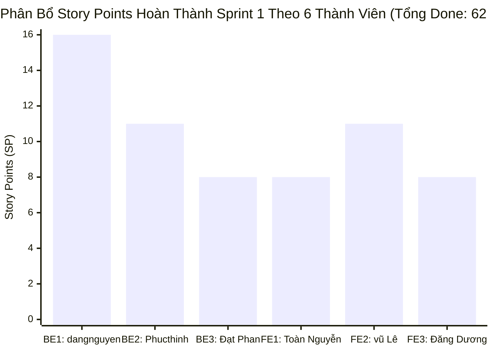
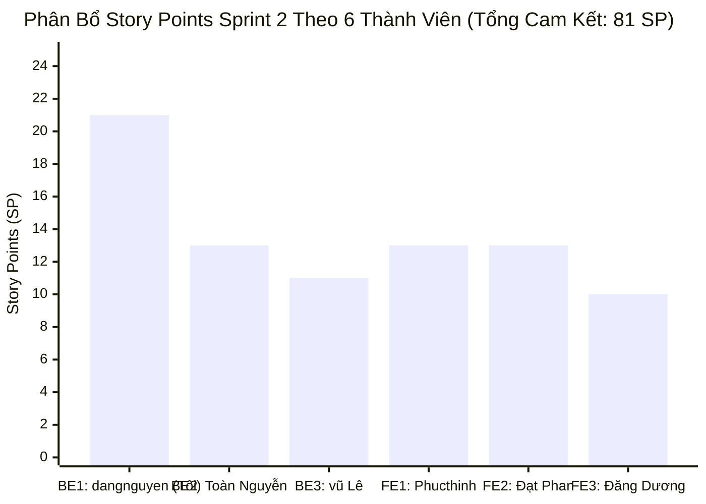

# 📱 GREENPHONE - TÀI LIỆU BACKLOG KỸ THUẬT & QUY TRÌNH PHÁT TRIỂN TOÀN DIỆN

> **Dự án:** GreenPhone - Hệ Thống Thương Mại Điện Tử Bán Điện Thoại Thông Minh (Smartphones & Phụ Kiện)  
> **Đơn vị:** Đồ án On-the-Job Training (OJT) - Rikkei Academy  
> **Quy mô:** 6 Thành viên (BE1: dangnguyen vu, BE2: 38.Phucthinh, BE3: Đạt Phan Văn, FE1: Toàn Nguyễn Văn, FE2: vũ Nguyễn Lê, FE3: Đăng Dương)  
> **Chu kỳ:** 4 Sprint (1 tuần / Sprint = 1 tháng hoàn thành)

---

## 📌 PHẦN 1: ĐỊNH HƯỚNG KIẾN TRÚC & CÔNG NGHỆ TỐI ƯU NHẤT CHO GREENPHONE

Dựa trên việc khảo sát toàn bộ mã nguồn hiện tại của GreenPhone, để dự án đạt chuẩn Doanh nghiệp và gây ấn tượng mạnh nhất với Hội đồng bảo vệ đồ án OJT, đây là **Bộ tiêu chuẩn công nghệ tốt nhất** cần áp dụng:

### 1. Kiến Trúc Backend (Spring Boot 3 / 4 & Java 17 LTS):
- **Core Framework:** Spring Boot WebMVC, Spring Data JPA, Spring Security (Stateless).
- **Database:** MySQL 8 InnoDB (sử dụng charset `utf8mb4_unicode_ci`).
- **Data Migration:** Chuẩn hóa toàn bộ schema bằng **Flyway Migration** (`V1__init_schema.sql`, `V2__seed_initial_data.sql`) thay cho việc chạy script SQL thủ công.
- **DTO Mapping:** Sử dụng **MapStruct** (`GenericMapper`, `PhoneMapper`, `OrderMapper`) thay vì Reflection để tối ưu hiệu năng và compile-time validation.
- **Tích hợp Lưu trữ Ảnh:** **Cloudinary CDN** với cơ chế tự động tối ưu định dạng `.webp` và kích thước ảnh.
- **Cổng thanh toán tự động:** **SePay VietQR Webhook** (Tự động xác nhận giao dịch chuyển khoản ngân hàng qua quét mã QR động) kết hợp thanh toán COD và hoàn trả kho tự động qua `@Scheduled` (`OrderTimeoutScheduler`).
- **Xử lý đồng thời (Concurrency Control):** Áp dụng **Khóa bi quan (`@Lock(LockModeType.PESSIMISTIC_WRITE)`)** trên biến thể điện thoại (`PhoneVariant`) để triệt tiêu lỗi bán âm kho (Overselling) khi Flash Sale các mẫu iPhone/Samsung hot.

### 2. Kiến Trúc Frontend (React 19 + Vite + TypeScript):
- **Giao diện & UI Library:** Ant Design (`antd`) kết hợp Tailwind CSS v4, Lucide Icons.
- **Quản lý State:** Redux Toolkit (`@reduxjs/toolkit`) kết hợp Redux Persist và Redux Saga cho các luồng async phức tạp.
- **Client Cache & Data Fetching:** TanStack React Query (`@tanstack/react-query`) giúp tự động cache dữ liệu sản phẩm và re-validate ngầm.
- **Form Validation:** React Hook Form kết hợp Zod Schema (`@hookform/resolvers/zod`).
- **Thanh toán:** Hiển thị mã VietQR động sinh theo mã đơn hàng, tự động lắng nghe Webhook xác nhận thành công.

### 3. Hạ Tầng DevOps & Triển Khai Thực Chiến:
- **Máy chủ VPS Production:** Ubuntu 24.04 (4GB RAM, 2GB Swap, UFW Firewall mở port 22, 80, 443).
- **Containerization:** Docker & Docker Compose chạy độc lập Backend container và Frontend Nginx container.
- **Nginx Reverse Proxy & SSL:** Cấu hình tên miền tĩnh, tự động cấp phát SSL miễn phí qua Certbot Let's Encrypt.
- **Quality Gate CI/CD:** GitHub Actions workflow tự động chạy kiểm thử đơn vị, đo độ bao phủ Jacoco và kiểm tra bảo mật npm audit mỗi khi tạo PR.

---

## 📌 PHẦN 2: QUY TẮC PHÁT TRIỂN BẮT BUỘC (ANTI-PATTERNS & RULES)

1. **Chuẩn đặt tên nhánh Git:**
   - Backend: `feat/be<x>-<tên-chức-năng>` (VD: `feat/be1-jwt-auth`, `feat/be2-phone-spec`, `feat/be3-sepay-qr`)
   - Frontend: `feat/fe<x>-<tên-chức-năng>` (VD: `feat/fe1-auth-pdp`, `feat/fe2-filter-sidebar`, `feat/fe3-checkout-qr`)
   - Sửa lỗi: `fix/<tên-lỗi>` (VD: `fix/stock-oversell-variant`)
2. **Quy chuẩn Response API:** Bắt buộc bọc qua `ApiResponse<T>`:
   ```json
   {
     "success": true,
     "message": "Thành công",
     "data": { ... },
     "timestamp": "2026-10-28T15:00:00Z"
   }
   ```
3. **5 Điều CẤM KỴ Kỹ thuật:**
   - **CẤM** gọi Repository trực tiếp trong Controller.
   - **CẤM** trả Entity JPA trực tiếp ra ngoài API. Bắt buộc map qua DTO bằng MapStruct.
   - **CẤM** lưu mật khẩu người dùng dạng thô. Phải băm bằng `BCryptPasswordEncoder`.
   - **CẤM** trừ tồn kho điện thoại ở bộ nhớ RAM mà không khóa dòng dữ liệu (`SELECT ... FOR UPDATE`).
   - **CẤM** để lộ khóa bí mật JWT, SePay API Key, Cloudinary Secret trong code git.

---

# 🚀 SPRINT 1: NỀN TẢNG KIẾN TRÚC, AUTHENTICATION, DANH MỤC ĐIỆN THOẠI & BASE FRONTEND

## 🎯 SPRINT 1 GOAL (MỤC TIÊU SPRINT 1)
> **"Hoàn thiện nền móng kiến trúc hệ thống (Backend Spring Boot 3 & Frontend React 19), bảo mật định danh JWT Bearer, hệ thống quản lý danh mục smartphone kèm ma trận biến thể cấu hình (Color/Storage), luồng mua sắm cốt lõi (Cart -> Multi-Step Checkout -> Order Success) cùng giao diện quản trị sản phẩm cơ bản; đóng gói và vận hành ổn định trên môi trường VPS Ubuntu."**

---

### 📊 BẢNG PHÂN BỔ STORY POINTS & VẬN TỐC NHÓM (TEAM VELOCITY) - SPRINT 1
- **Quy mô:** 6 Thành viên (Thời lượng: 2 tuần / 10 ngày làm việc)
- **Phương pháp ước lượng:** Scrum Planning Poker (Thang Fibonacci: 1, 2, 3, 5, 8)
- **Tổng Story Points cam kết ban đầu:** **70 SP (18 tasks)**
- **Tổng Story Points hoàn thành thực tế (Done):** **62 SP (16 tasks - 88.6%)**
- **Nhiệm vụ chuyển tiếp Sprint 2 (Delay):** **8 SP (2 tasks - 11.4%)**
- **Vận tốc thực tế (Actual Velocity):** **10.3 SP / thành viên**

| Thành viên | Vai trò phụ trách | Cam kết (SP) | Hoàn thành thực tế | Delay sang S2 | Tỷ lệ bàn giao |
| :--- | :--- | :---: | :---: | :---: | :---: |
| **dangnguyen vu** | BE 1 (Lead Tech, Infra & Auth + Base FE) | 16 SP | **16 SP** | 0 SP | ✅ 100% |
| **38.Phucthinh** | BE 2 (Catalog, Media & Spec Tree) | 11 SP | **11 SP** | 0 SP | ✅ 100% |
| **Đạt Phan Văn** | BE 3 (Cart, Voucher Engine & Stock) | 11 SP | **8 SP** | 3 SP (Validate Variant) | ⚠️ 72.7% |
| **Toàn Nguyễn Văn** | FE 1 (Auth & PDP) | 8 SP | **8 SP** | 0 SP | ✅ 100% |
| **vũ Nguyễn Lê** | FE 2 (Layout, Homepage & Filters) | 11 SP | **11 SP** | 0 SP | ✅ 100% |
| **Đăng Dương** | FE 3 (Checkout, Cart & Admin CRUD) | 13 SP | **8 SP** | 5 SP (Multi-step Checkout) | ⚠️ 61.5% |
| **TỔNG CỘNG** | **Toàn đội GreenPhone** | **70 SP** | **62 SP (16 tasks)** | **8 SP (2 tasks)** | **🎯 88.6% DONE** |

> ⚠️ **Báo cáo 2 nhiệm vụ Delay:**
> 1. `[3 SP] [BE3] Kiểm Tra Tồn Kho Biến Thể Thời Gian Thực`: Chuyển sang Sprint 2 để tích hợp đồng bộ với khóa bi quan `@Lock(LockModeType.PESSIMISTIC_WRITE)` và SePay Webhook.
> 2. `[5 SP] [FE3] Giao Diện Đặt Hàng & Thanh Toán Đa Bước`: Chuyển sang Sprint 2 để ghép trực tiếp với API thanh toán VietQR động.



---

### 👤 BE 1: dangnguyen vu (`@dangnguyenvu`)

#### 🎯 Task BE1-01: Base Architecture, Exception Handling & API Response Standard [3 SP]
- **Mục tiêu:** Xây dựng khung chuẩn hệ thống Backend Spring Boot: Cấu trúc DTO chuẩn `ApiResponse<T>`, bộ mã lỗi định danh `ErrorCode`, bắt lỗi tập trung `GlobalExceptionHandler`, cấu hình CORS và Swagger OpenAPI 3.
- **Đường dẫn file:**
  - `GreenPhone-Backend/src/main/java/com/re/greenphone/common/dto/ApiResponse.java`
  - `GreenPhone-Backend/src/main/java/com/re/greenphone/common/exception/GlobalExceptionHandler.java`
  - `GreenPhone-Backend/src/main/java/com/re/greenphone/common/exception/AppException.java`
  - `GreenPhone-Backend/src/main/java/com/re/greenphone/config/CorsConfig.java`
  - `GreenPhone-Backend/src/main/java/com/re/greenphone/config/LoggingAspect.java`
- **Cần gì:** Spring AOP, `@RestControllerAdvice`, MapStruct GenericMapper.
- **Làm gì:** Bắt các exception `ResourceNotFoundException`, `BadRequestException`, `MethodArgumentNotValidException`, ghi log thực thi service qua AOP.
- **CẤM ĐIỀU GÌ:** Cấm in stacktrace ra console `e.printStackTrace()`. Cấm trả về 200 OK khi có lỗi.
- **Tiêu chuẩn nghiệm thu:** Mọi lỗi nhập liệu hoặc lỗi hệ thống đều trả về JSON đúng format `ApiResponse` kèm HTTP Status chuẩn.

#### 🎯 Task BE1-02: Authentication Service (JWT Bearer & User Security) [5 SP]
- **Mục tiêu:** Hệ thống đăng ký tài khoản khách hàng, đăng nhập sinh chuỗi mã hóa JWT Bearer Token, kiểm tra tài khoản kích hoạt và phân quyền Role `ROLE_CUSTOMER` vs `ROLE_ADMIN`.
- **Đường dẫn file:**
  - `GreenPhone-Backend/src/main/java/com/re/greenphone/security/JwtTokenProvider.java`
  - `GreenPhone-Backend/src/main/java/com/re/greenphone/security/JwtAuthenticationFilter.java`
  - `GreenPhone-Backend/src/main/java/com/re/greenphone/config/SecurityConfig.java`
  - `GreenPhone-Backend/src/main/java/com/re/greenphone/service/AuthService.java`
  - `GreenPhone-Backend/src/main/java/com/re/greenphone/controller/AuthController.java`
- **Cần gì:** Thư viện `jjwt-api:0.12.6`, `BCryptPasswordEncoder`.
- **Làm gì:** API `POST /api/v1/auth/register`, `POST /api/v1/auth/login`, mã hóa password, trích xuất Claims từ JWT Header.
- **CẤM ĐIỀU GÌ:** Cấm lưu secret key trong code Java. Cấm lưu mật khẩu thô.
- **Tiêu chuẩn nghiệm thu:** Test Swagger đăng ký tài khoản mới $\rightarrow$ đăng nhập nhận JWT $\rightarrow$ gửi JWT vào header gọi được API lấy thông tin profile cá nhân.

#### 🎯 Task BE1-03: User Profile & Sổ Địa Chỉ Giao Hàng (User Address Management) [3 SP]
- **Mục tiêu:** Cho phép khách hàng quản lý thông tin hồ sơ (Họ tên, SĐT, Email, Avatar) và cập nhật địa chỉ giao hàng nhận máy.
- **Đường dẫn file:**
  - `GreenPhone-Backend/src/main/java/com/re/greenphone/entity/User.java`
  - `GreenPhone-Backend/src/main/java/com/re/greenphone/service/UserService.java`
  - `GreenPhone-Backend/src/main/java/com/re/greenphone/controller/UserController.java`
  - `GreenPhone-Backend/src/main/java/com/re/greenphone/dto/request/UserProfileRequest.java`
- **Cần gì:** Bảng `USERS`, quan hệ Role, Spring Validation `@Valid`.
- **Làm gì:** API `GET /api/v1/users/profile`, `PUT /api/v1/users/profile`, `PUT /api/v1/users/change-password`.
- **CẤM ĐIỀU GÌ:** Cấm user này cập nhật đè thông tin tài khoản của user khác.
- **Tiêu chuẩn nghiệm thu:** Cập nhật thông tin profile và đổi mật khẩu thành công, kiểm tra mật khẩu cũ chính xác mới cho đổi.

---

### 👤 BE 2: 38.Phucthinh (`@38phucthinh`)

#### 🎯 Task BE2-01: Tích Hợp Upload Đa Phương Tiện (Cloudinary Image Service) [3 SP]
- **Mục tiêu:** Service upload ảnh điện thoại các góc cạnh, ảnh banner quảng cáo và ảnh avatar người dùng lên Cloudinary CDN với độ trễ thấp và tự động tối ưu hóa.
- **Đường dẫn file:**
  - `GreenPhone-Backend/src/main/java/com/re/greenphone/config/CloudinaryConfig.java`
  - `GreenPhone-Backend/src/main/java/com/re/greenphone/service/CloudinaryService.java`
  - `GreenPhone-Backend/src/main/java/com/re/greenphone/controller/admin/AdminPhoneController.java` (upload endpoints)
- **Cần gì:** Thư viện `cloudinary-http44:1.38.0`, thông số môi trường `.env`.
- **Làm gì:** Viết hàm nhận `MultipartFile`, kiểm tra định dạng (.jpg, .png, .webp), dung lượng <= 10MB, upload lên folder `greenphone/phones` và trả về secure HTTPS URL.
- **CẤM ĐIỀU GÌ:** Cấm lưu trữ ảnh trực tiếp trong thư mục ổ cứng server. Cấm upload file không lọc đuôi extension.
- **Tiêu chuẩn nghiệm thu:** Upload thử 1 ảnh điện thoại trả về link CDN `https://res.cloudinary.com/...` hiển thị ảnh rõ nét.

#### 🎯 Task BE2-02: Quản Lý Hãng Sản Xuất (Brand) & Banner Khuyến Mãi [3 SP]
- **Mục tiêu:** Cung cấp API quản lý các thương hiệu smartphone hàng đầu (Apple, Samsung, Xiaomi, OPPO, Vivo) và các banner chiến dịch quảng cáo trang chủ.
- **Đường dẫn file:**
  - `GreenPhone-Backend/src/main/java/com/re/greenphone/entity/Brand.java`
  - `GreenPhone-Backend/src/main/java/com/re/greenphone/entity/Banner.java`
  - `GreenPhone-Backend/src/main/java/com/re/greenphone/service/BrandService.java`
  - `GreenPhone-Backend/src/main/java/com/re/greenphone/service/BannerService.java`
  - `GreenPhone-Backend/src/main/java/com/re/greenphone/controller/BrandController.java`
  - `GreenPhone-Backend/src/main/java/com/re/greenphone/controller/BannerController.java`
- **Cần gì:** Bảng `BRAND`, `BANNER`, MapStruct `BrandMapper`, `BannerMapper`.
- **Làm gì:** API Public lấy danh sách Hãng và Banner đang hoạt động (`is_active = true`); API Admin để thêm/sửa/xóa.
- **CẤM ĐIỀU GÌ:** Cấm xóa Hãng nếu đang có dòng điện thoại thuộc hãng đó trong hệ thống.
- **Tiêu chuẩn nghiệm thu:** Gọi `GET /api/v1/brands` trả về đầy đủ logo và tên các hãng Apple, Samsung, Xiaomi.

#### 🎯 Task BE2-03: Cây Thuộc Tính & Thông Số Kỹ Thuật (Option & OptionItem Tree) [5 SP]
- **Mục tiêu:** Xây dựng hệ thống cấu hình thông số kỹ thuật linh hoạt cho smartphone: RAM (8GB, 12GB, 16GB), Dung lượng ROM (128GB, 256GB, 512GB, 1TB), Màu sắc, Chipset, Dung lượng Pin.
- **Đường dẫn file:**
  - `GreenPhone-Backend/src/main/java/com/re/greenphone/entity/Option.java`
  - `GreenPhone-Backend/src/main/java/com/re/greenphone/entity/OptionItem.java`
  - `GreenPhone-Backend/src/main/java/com/re/greenphone/service/OptionService.java`
  - `GreenPhone-Backend/src/main/java/com/re/greenphone/controller/OptionController.java`
  - `GreenPhone-Backend/src/main/java/com/re/greenphone/dto/response/OptionTreeDTO.java`
- **Cần gì:** Quan hệ 1-N giữa `Option` (loại thông số) và `OptionItem` (giá trị cụ thể).
- **Làm gì:** API trả về cây thuộc tính dạng tree để Frontend render dropdown chọn cấu hình điện thoại và bộ lọc.
- **Tiêu chuẩn nghiệm thu:** API trả về nhóm RAM gồm các giá trị [8GB, 12GB], nhóm Dung lượng gồm [128GB, 256GB, 512GB].

---

### 👤 BE 3: Đạt Phan Văn (`@dtphanvan3`)

#### 🎯 Task BE3-01: Module Quản Lý Mã Giảm Giá & Voucher Engine (Promotion Service) [5 SP]
- **Mục tiêu:** Xây dựng nghiệp vụ voucher khuyến mãi giảm giá theo % hoặc tiền cố định, kiểm tra điều kiện áp dụng (ngày hiệu lực, đơn hàng tối thiểu, lượt dùng còn lại).
- **Đường dẫn file:**
  - `GreenPhone-Backend/src/main/java/com/re/greenphone/entity/Promotion.java`
  - `GreenPhone-Backend/src/main/java/com/re/greenphone/entity/UserPromotion.java`
  - `GreenPhone-Backend/src/main/java/com/re/greenphone/service/PromotionService.java`
  - `GreenPhone-Backend/src/main/java/com/re/greenphone/controller/PromotionController.java`
  - `GreenPhone-Backend/src/main/java/com/re/greenphone/dto/request/ApplyPromotionRequest.java`
- **Cần gì:** Bảng `PROMOTION`, Enum `DiscountType` (PERCENT, FIXED_AMOUNT).
- **Làm gì:** Viết hàm validate voucher: kiểm tra thời hạn, số lượt sử dụng tối đa, giá trị đơn hàng tối thiểu, tính số tiền chiết khấu thực tế.
- **CẤM ĐIỀU GÌ:** Cấm tiền giảm giá lớn hơn tổng tiền đơn hàng. Cấm dùng voucher đã hết lượt.
- **Tiêu chuẩn nghiệm thu:** Áp dụng mã `GREENPHONE500K` vào đơn 10 triệu thành công trừ đúng 500k; thử áp mã hết hạn báo lỗi rõ ràng.

#### 🎯 Task BE3-02: Giỏ Hàng & Quản Lý Cart Items (Shopping Cart Service) [3 SP]
- **Mục tiêu:** Quản lý giỏ hàng mua sắm của khách hàng: thêm máy theo biến thể màu/dung lượng, tăng giảm số lượng, tính tổng tiền tạm tính realtime.
- **Đường dẫn file:**
  - `GreenPhone-Backend/src/main/java/com/re/greenphone/entity/Cart.java`
  - `GreenPhone-Backend/src/main/java/com/re/greenphone/entity/CartItem.java`
  - `GreenPhone-Backend/src/main/java/com/re/greenphone/service/CartService.java`
  - `GreenPhone-Backend/src/main/java/com/re/greenphone/controller/CartController.java`
  - `GreenPhone-Backend/src/main/java/com/re/greenphone/dto/request/CartItemRequest.java`
- **Cần gì:** Bảng `CART`, `CART_ITEM` liên kết với `PHONE_VARIANT`.
- **Làm gì:** API `GET /api/v1/cart`, `POST /api/v1/cart/items`, `PUT /api/v1/cart/items/{id}`, `DELETE /api/v1/cart/items/{id}`.
- **CẤM ĐIỀU GÌ:** Cấm thêm sản phẩm vào giỏ khi số lượng trong kho đã hết (`stock == 0`).
- **Tiêu chuẩn nghiệm thu:** Thêm 1 chiếc iPhone 15 Pro Max 256GB vào giỏ, kiểm tra giỏ hàng thấy đúng tên máy, màu sắc, giá và số lượng.

#### 🎯 Task BE3-03: Kiểm Tra Tồn Kho Biến Thể Thời Gian Thực & Validate Variant [3 SP]
- **Mục tiêu:** Service kiểm tra số lượng tồn kho từng SKU biến thể điện thoại (kết hợp Màu + Dung lượng ROM) để báo trạng thái còn hàng/hết hàng cho client.
- **Đường dẫn file:**
  - `GreenPhone-Backend/src/main/java/com/re/greenphone/entity/PhoneVariant.java`
  - `GreenPhone-Backend/src/main/java/com/re/greenphone/repository/PhoneVariantRepository.java`
  - `GreenPhone-Backend/src/main/java/com/re/greenphone/service/PhoneService.java`
- **Cần gì:** Bảng `PHONE_VARIANT` (`sku`, `price`, `stock_quantity`, `phone_id`).
- **Làm gì:** Viết query kiểm tra nhanh số lượng tồn kho theo variant ID trước khi cho phép thêm vào giỏ hoặc đặt hàng.
- **Tiêu chuẩn nghiệm thu:** Biến thể có tồn kho = 0 trả về trạng thái `OUT_OF_STOCK`.

---

### 👤 FE 1: Toàn Nguyễn Văn (`@toannguynvan12`)

#### 🎯 Task FE1-01: Khởi Tạo Dự Án Frontend & Cấu Hình Kiến Trúc Base (React 19 + Vite) [5 SP]
- **Mục tiêu:** Dựng khung chuẩn Frontend: Cấu hình Vite, Tailwind CSS, Ant Design Theme (màu chủ đạo: Xanh lá Green lá mạ công nghệ `#10B981` & Đen sang trọng), Axios Client tự động đính kèm JWT Bearer.
- **Đường dẫn file:**
  - `Frontend/src/services/api.ts` (Axios Client)
  - `Frontend/src/store/index.ts` (Redux Toolkit store)
  - `Frontend/src/layouts/RootLayout.tsx`
  - `Frontend/src/routes/index.tsx`
- **Cần gì:** Thư viện `axios`, `@reduxjs/toolkit`, `react-router-dom:v7`, `antd`.
- **Làm gì:** Cấu hình Interceptors gắn `Authorization: Bearer <token>` vào mọi request bảo vệ; xử lý bắt lỗi 401 tự động xóa token và chuyển về trang Login.
- **Tiêu chuẩn nghiệm thu:** Dự án build không lỗi qua `npm run build`, layout hiển thị đúng theme màu sắc của GreenPhone.

#### 🎯 Task FE1-02: Giao Diện Đăng Ký, Đăng Nhập & Quên Mật Khẩu (Auth Pages) [3 SP]
- **Mục tiêu:** Giao diện trang Login và Register chuyên nghiệp, kiểm tra tính hợp lệ của form bằng React Hook Form + Zod, hỗ trợ thông báo lỗi trực quan.
- **Đường dẫn file:**
  - `Frontend/src/pages/auth/LoginPage.tsx`
  - `Frontend/src/pages/auth/RegisterPage.tsx`
  - `Frontend/src/pages/auth/ForgotPasswordPage.tsx`
  - `Frontend/src/services/authService.ts`
- **Cần gì:** `react-hook-form`, `zod`, Ant Design Input & Button components.
- **Làm gì:** Validate email đúng định dạng, mật khẩu tối thiểu 8 ký tự; submit form gọi API backend, lưu token vào Redux store và redirect về trang chủ.
- **CẤM ĐIỀU GÌ:** Cấm gửi request khi form validate còn lỗi.
- **Tiêu chuẩn nghiệm thu:** Nhập đúng tài khoản đăng nhập thành công, Header tự động hiển thị tên người dùng và avatar.

#### 🎯 Task FE1-03: Giao Diện Trang Chi Tiết Điện Thoại (Product Detail Page - PDP) [5 SP]
- **Mục tiêu:** Màn hình xem chi tiết điện thoại: Slider ảnh sản phẩm phóng to, bảng chọn dung lượng (128GB, 256GB, 512GB) và màu sắc (Titan Tự nhiên, Titan Đen, Titan Xanh), giá bán tự động đổi theo cấu hình chọn, nút "Thêm vào giỏ" và "Mua ngay".
- **Đường dẫn file:**
  - `Frontend/src/pages/product/ProductDetailPage.tsx`
  - `Frontend/src/components/product/ProductGallery.tsx`
  - `Frontend/src/components/product/VariantSelector.tsx`
  - `Frontend/src/components/product/TechnicalSpecsTable.tsx`
- **Cần gì:** Swiper slider ảnh, bảng thông số kỹ thuật (Màn hình, Chip, RAM, Pin, Camera).
- **Làm gì:** Đổi cấu hình ROM/Màu thì cập nhật giá bán và trạng thái còn hàng/hết hàng realtime.
- **Tiêu chuẩn nghiệm thu:** Bấm chọn iPhone 15 Pro Max bản 512GB giá tự động nhảy từ 29tr lên 35tr đúng với dữ liệu backend.

---

### 👤 FE 2: vũ Nguyễn Lê (`@vunguynle1`)

#### 🎯 Task FE2-01: Thiết Kế Header, Navigation Bar & Footer Thương Hiệu [3 SP]
- **Mục tiêu:** Xây dựng Header chuẩn e-commerce công nghệ: Logo GreenPhone, ô tìm kiếm thông minh có gợi ý, danh mục hãng (Apple, Samsung, Xiaomi), icon giỏ hàng kèm badge số lượng, menu tài khoản người dùng và Footer chính sách bảo hành.
- **Đường dẫn file:**
  - `Frontend/src/components/layout/Header.tsx`
  - `Frontend/src/components/layout/Navbar.tsx`
  - `Frontend/src/components/layout/Footer.tsx`
  - `Frontend/src/components/layout/SearchBar.tsx`
- **Cần gì:** Lucide icons (`Smartphone`, `ShoppingCart`, `User`, `Search`, `ShieldCheck`).
- **Làm gì:** Header cố định khi cuộn trang (Sticky), hiển thị số lượng sản phẩm trong giỏ lấy từ Redux cart state.
- **Tiêu chuẩn nghiệm thu:** Giao diện co giãn chuẩn trên cả Desktop và màn hình điện thoại di động (Responsive).

#### 🎯 Task FE2-02: Giao Diện Trang Chủ (Homepage) & Banner Chiến Dịch [3 SP]
- **Mục tiêu:** Trang chủ bắt mắt: Slider banner quảng cáo chiến dịch mở bán, danh mục chọn nhanh theo hãng, danh sách "Điện thoại hot nhất", "Flash Sale giá sốc", và cam kết chính hãng 100% đổi mới 30 ngày.
- **Đường dẫn file:**
  - `Frontend/src/pages/home/HomePage.tsx`
  - `Frontend/src/components/home/HeroBannerSlider.tsx`
  - `Frontend/src/components/home/BrandQuickSelect.tsx`
  - `Frontend/src/components/home/ProductCard.tsx`
- **Cần gì:** Thư viện `swiper` tạo hiệu ứng chuyển banner mượt mà.
- **Làm gì:** Hiển thị thẻ card điện thoại gồm ảnh đại diện, tên máy, nhãn giảm giá %, giá bán và giá niêm yết gạch ngang, thông số tóm tắt (RAM/ROM).
- **Tiêu chuẩn nghiệm thu:** Bấm vào thẻ điện thoại chuyển hướng mượt mà sang trang chi tiết đúng slug của máy.

#### 🎯 Task FE2-03: Giao Diện Trang Danh Sách Sản Phẩm & Sidebar Bộ Lọc Động [5 SP]
- **Mục tiêu:** Trang `/products` có Sidebar lọc đa tiêu chí: Lọc theo Hãng (Apple, Samsung, Xiaomi), Lọc theo Mức giá (Dưới 5 triệu, 5-10 triệu, 10-20 triệu, Trên 20 triệu), Lọc theo RAM, Bộ nhớ trong ROM; đồng bộ URL query parameters.
- **Đường dẫn file:**
  - `Frontend/src/pages/product/ProductsPage.tsx`
  - `Frontend/src/components/product/FilterSidebar.tsx`
  - `Frontend/src/components/product/SortSelector.tsx`
  - `Frontend/src/components/product/ActiveFilters.tsx`
- **Cần gì:** `useSearchParams` từ React Router để đồng bộ bộ lọc lên thanh địa chỉ URL.
- **Làm gì:** Khi tick chọn "Apple" và "Trên 20 triệu", danh sách lập tức lọc lại các dòng iPhone cao cấp mà không cần tải lại toàn bộ trang.
- **Tiêu chuẩn nghiệm thu:** Copy link URL có chứa query param gửi sang tab khác vẫn giữ nguyên trạng thái các bộ lọc đang chọn.

---

### 👤 FE 3: Đăng Dương (`@dangduongre`)

#### 🎯 Task FE3-01: Giao Diện Đặt Hàng & Thanh Toán Đa Bước (Multi-Step Checkout Flow) [5 SP]
- **Mục tiêu:** Xây dựng giao diện đặt hàng và thanh toán đa bước (Multi-step Checkout) chuyên nghiệp cho GreenPhone: Tiếp nhận thông tin người mua, địa chỉ nhận hàng, chọn hình thức giao hàng, chọn phương thức thanh toán (COD / Chuyển khoản QR), tóm tắt đơn hàng và chuyển sang trang Đặt hàng thành công (`/checkout/success`).
- **Đường dẫn file:**
  - `Frontend/src/pages/CheckoutPage.tsx`
  - `Frontend/src/pages/CheckoutSuccessPage.tsx`
  - `Frontend/src/components/checkout/CheckoutSteps.tsx`
  - `Frontend/src/components/checkout/ShippingForm.tsx`
  - `Frontend/src/components/checkout/PaymentMethodSelect.tsx`
  - `Frontend/src/components/checkout/OrderSummary.tsx`
  - `Frontend/src/store/slices/checkoutSlice.ts`
- **Cần gì:** Ant Design Form, Steps, Button, Redux `checkoutSlice` và `cartSlice`.
- **Làm gì:** Tiến trình 3 bước (1. Giao hàng -> 2. Thanh toán -> 3. Hoàn tất), validate form chặt chẽ (Tên >= 2 ký tự, SĐT đúng 10 số, Địa chỉ >= 5 ký tự), tính toán tiền hàng kèm voucher và phí ship, đặt hàng xong xóa giỏ hàng và điều hướng sang `/checkout/success`.
- **Tiêu chuẩn nghiệm thu:** Nhập sai định dạng SĐT báo lỗi ngay; đặt hàng thành công giỏ hàng tự động reset về 0 và hiển thị mã đơn hàng.

#### 🎯 Task FE3-02: Trang Giỏ Hàng Chi Tiết (/cart) & Áp Dụng Mã Giảm Giá [3 SP]
- **Mục tiêu:** Trang xem lại toàn bộ giỏ hàng trước khi thanh toán: danh sách máy, phân loại cấu hình (Màu sắc, Dung lượng), ô nhập mã Voucher giảm giá, bảng tính chi tiết tiền hàng và tiền chiết khấu.
- **Đường dẫn file:**
  - `Frontend/src/pages/cart/CartPage.tsx`
  - `Frontend/src/components/cart/CouponInput.tsx`
  - `Frontend/src/components/cart/CartSummary.tsx`
- **Cần gì:** Tích hợp API kiểm tra voucher của BE3.
- **Làm gì:** Nhập mã giảm giá hợp lệ thì hiển thị số tiền được giảm màu xanh lá cây và trừ trực tiếp vào tổng tiền cần thanh toán.
- **Tiêu chuẩn nghiệm thu:** Xóa sản phẩm khỏi giỏ có hộp thoại xác nhận; giỏ hàng rỗng hiển thị thông báo "Chưa có sản phẩm nào".

#### 🎯 Task FE3-03: Giao Diện Quản Trị: Quản Lý Sản Phẩm & Biến Thể Kho Máy (Admin Product CRUD) [5 SP]
- **Mục tiêu:** Giao diện dành cho Admin để thêm mới mẫu điện thoại, upload ảnh lên Cloudinary, tạo ma trận biến thể cấu hình (Dung lượng 128/256/512GB + Màu Đen/Trắng/Xanh) kèm số lượng tồn kho từng loại.
- **Đường dẫn file:**
  - `Frontend/src/pages/admin/AdminProductsPage.tsx`
  - `Frontend/src/components/admin/ProductFormModal.tsx`
  - `Frontend/src/components/admin/VariantStockTable.tsx`
  - `Frontend/src/services/adminProductService.ts`
- **Cần gì:** Ant Design Table, Modal, Upload, Form components.
- **Làm gì:** Bảng danh sách điện thoại có tìm kiếm theo tên, lọc theo hãng, nút Xem/Sửa/Xóa. Form thêm mới hỗ trợ kéo thả nhiều ảnh.
- **Tiêu chuẩn nghiệm thu:** Admin thêm thành công 1 mẫu điện thoại mới kèm 3 biến thể dung lượng, ra ngoài trang chủ thấy hiển thị ngay.

---

# 🚀 SPRINT 2: BẢO MẬT PRODUCTION, ĐỒNG BỘ GIỎ HÀNG, QUẢN TRỊ ĐƠN HÀNG & NÂNG CẤP UI/UX

## 🎯 SPRINT 2 GOAL (MỤC TIÊU SPRINT 2)
> **"Nâng cấp toàn diện GreenPhone sẵn sàng cho môi trường Production: Tối ưu hiệu năng với Redis Cache và Connection Pool; bảo mật danh tính với Refresh Token, Redis OTP và Token Blacklist; đồng bộ giỏ hàng thời gian thực giữa Client và Server; siết chặt máy trạng thái đơn hàng (Order State Machine), bổ sung giao diện xem chi tiết đơn cho Admin và cho phép khách tự hủy đơn; tái thiết kế bộ chọn biến thể smartphone và nâng tầm trải nghiệm mua sắm công nghệ."**

---

### 📊 BẢNG PHÂN BỔ STORY POINTS & PHÂN CÔNG THÀNH VIÊN - SPRINT 2
- **Quy mô:** 6 Thành viên (Thời lượng: 2 tuần / 10 ngày làm việc)
- **Quy tắc phân công Sprint 2:** Xoay tua vai trò (Thành viên làm BE ở Sprint 1 chuyển sang làm FE ở Sprint 2, riêng Lead BE giữ vị trí kỹ thuật cốt lõi).
  - **dangnguyen vu (Tôi):** Tiếp tục giữ vai trò **BE 1** (Tech Lead & Infra / Core Security).
  - **Toàn Nguyễn Văn** (từ FE 1): Chuyển sang **BE 2** (Core Commerce & Order Flow).
  - **vũ Nguyễn Lê** (từ FE 2): Chuyển sang **BE 3** (Orders, Inventory Audit & Search).
  - **38.Phucthinh** (từ BE 2): Chuyển sang **FE 1** (Catalog, PDP & Cart Frontend).
  - **Đạt Phan Văn** (từ BE 3): Chuyển sang **FE 2** (Order Operations & Customer Order UI).
  - **Đăng Dương** (từ FE 3): Tiếp tục đảm nhiệm **FE 3** (Inventory UI & Review Enhancements).
- **Tổng Story Points cam kết Sprint 2:** **67 SP (18 tasks chi tiết)**

| Thành viên | Vai trò Sprint 2 | Nhiệm vụ trọng tâm | Cam kết (SP) |
| :--- | :--- | :--- | :---: |
| **dangnguyen vu** | **BE 1** (Lead Tech, Infra & Sec) | Redis Cache, Redis OTP, Refresh Token & Blacklist, Hikari/ThreadPool, SSL & Nginx | **21 SP** (5 tasks) |
| **Toàn Nguyễn Văn** | **BE 2** (Core Commerce & Orders) | Cart API Synchronization, Order State Machine, Idempotency Key | **13 SP** (3 tasks) |
| **vũ Nguyễn Lê** | **BE 3** (Orders & Inventory Audit) | Client Order Cancel API, Low-Stock Alert & Audit Log, Full-Text Search | **11 SP** (3 tasks) |
| **38.Phucthinh** | **FE 1** (PDP, Cart & Media UI) | Variant Selector (Storage/Color Swatch), Redux Cart Sync, Image Zoom & Skeleton | **13 SP** (3 tasks) |
| **Đạt Phan Văn** | **FE 2** (Order UI & State Admin) | Admin Order Detail Drawer, Client Order Cancel & Timeline, Admin State Guards | **13 SP** (3 tasks) |
| **Đăng Dương** | **FE 3** (Inventory & Review UI) | Low-Stock & Audit Log UI, Review Photo Upload & Admin Order Date Range | **10 SP** (2 tasks) |
| **TỔNG CỘNG** | **Toàn đội GreenPhone** | **18 Nhiệm vụ Production & Nâng Cấp Nghiệp Vụ** | **🎯 67 SP** |



---

## 👥 CHI TIẾT NHIỆM VỤ SPRINT 2 TỪNG THÀNH VIÊN

---

### 👤 BE 1: dangnguyen vu (`@dangnguyenvu`) - Tech Lead, Infra & Core Security

#### 🎯 Task BE1-01: Tích Hợp Redis Cache Cho Catalog, Promotion & System Settings [5 SP]
- **Lỗi ở đâu / Bối cảnh:** Hiện tại hệ thống hoàn toàn không có tầng Caching. Mọi request xem danh sách điện thoại, chi tiết cấu hình, danh mục hãng, banner quảng cáo, voucher và cài đặt phí vận chuyển đều query trực tiếp vào MySQL. Khi có vài chục người truy cập đồng thời, MySQL bị nghẽn CPU và I/O.
- **Đường dẫn file tác động:**
  - `GreenPhone-Backend/build.gradle` (Thêm `spring-boot-starter-data-redis`)
  - `GreenPhone-Backend/src/main/resources/application.yml`
  - `GreenPhone-Backend/src/main/java/com/re/greenphone/config/RedisConfig.java`
  - `GreenPhone-Backend/src/main/java/com/re/greenphone/service/PhoneService.java`
  - `GreenPhone-Backend/src/main/java/com/re/greenphone/service/BrandService.java`
  - `GreenPhone-Backend/src/main/java/com/re/greenphone/service/PromotionService.java`
  - `GreenPhone-Backend/src/main/java/com/re/greenphone/service/SettingsService.java`
  - `deploy/docker-compose.prod.yml` (Bổ sung container `redis:7-alpine`)
- **Giải pháp & Hướng sửa:**
  1. Thêm dịch vụ `redis` vào Docker Compose với volume lưu trữ cache độc lập.
  2. Cấu hình Spring Data Redis, kích hoạt `@EnableCaching` và khai báo `RedisCacheManager` với serializer JSON Jackson (`GenericJackson2JsonRedisSerializer`).
  3. Áp dụng `@Cacheable(value = "phones", key = "#id")`, `@Cacheable(value = "brands")`, `@Cacheable(value = "settings")`.
  4. Đặt TTL phù hợp: Catalog (1 giờ), Settings (24 giờ). Áp dụng `@CacheEvict(allEntries = true)` khi Admin thêm/sửa/xóa sản phẩm, banner, cài đặt.
- **Kịch bản kiểm thử (How to test):**
  1. Mở terminal gõ `redis-cli monitor`.
  2. Gọi API `GET /api/phones/1` lần 1: MySQL ghi nhận 1 truy vấn SELECT, Redis lưu key `phones::1`.
  3. Gọi API `GET /api/phones/1` lần 2: Không có bất kỳ truy vấn SQL nào xuống MySQL, response trả về ngay lập tức với độ trễ < 5ms.
  4. Admin gọi `PUT /api/admin/phones/1` sửa giá: Redis lập tức xóa key `phones::1`. Lần gọi tiếp theo tự động nạp dữ liệu mới vào cache.
- **Tiêu chuẩn nghiệm thu:** Giảm 80% số lượng truy vấn đọc xuống MySQL đối với các màn hình tĩnh; dữ liệu cache tự động cập nhật khi Admin thay đổi thông tin.

#### 🎯 Task BE1-02: Tái Cấu Trúc OTP Xác Thực: Lưu Trữ Redis Có TTL & Chống Brute-Force [3 SP]
- **Lỗi ở đâu / Bối cảnh:** Trong `AuthService.java`, OTP đang lưu bằng `ConcurrentHashMap<String, String> otpCache` in-memory. Hậu quả: Không có thời hạn hết hạn (OTP tồn tại vĩnh viễn), không giới hạn số lần nhập sai (dễ bị tấn công vét cạn brute-force), mất sạch OTP khi restart server hoặc scale multi-instance.
- **Đường dẫn file tác động:**
  - `GreenPhone-Backend/src/main/java/com/re/greenphone/service/AuthService.java`
  - `GreenPhone-Backend/src/main/java/com/re/greenphone/config/RedisConfig.java`
- **Giải pháp & Hướng sửa:**
  1. Xóa bỏ `otpCache` dạng ConcurrentHashMap trong `AuthService.java`.
  2. Dùng `StringRedisTemplate` lưu OTP: `redisTemplate.opsForValue().set("otp:" + email, otp, 3, TimeUnit.MINUTES)`.
  3. Bổ sung cơ chế chống brute-force: Lưu key đếm số lần thử `otp_attempts:{email}` với TTL 3 phút. Mỗi lần nhập sai tăng biến đếm lên 1. Nếu số lần nhập sai >= 5, xóa OTP ngay lập tức và ném `BadRequestException("Bạn đã nhập sai OTP quá 5 lần. Vui lòng yêu cầu mã mới.")`.
- **Kịch bản kiểm thử (How to test):**
  1. Gọi API `POST /api/auth/register` -> Kiểm tra Redis: `GET otp:test@gmail.com` thấy mã 6 số và TTL giảm dần từ 180s.
  2. Đợi quá 3 phút, gọi `POST /api/auth/verify-otp` -> Báo lỗi `400 Bad Request: Mã OTP không hợp lệ hoặc đã hết hạn`.
  3. Gửi lại OTP mới, cố tình nhập sai liên tục 5 lần -> Lần thứ 5 bị khóa ngay và OTP trong Redis tự động bị tiêu hủy.
  4. Khởi động lại backend container (`docker restart greenphone-backend`) -> Khách nhập OTP vẫn xác thực thành công bình thường.
- **Tiêu chuẩn nghiệm thu:** 100% OTP tự hủy sau đúng 180 giây; chống được hành vi dò mã OTP tự động; không phụ thuộc vào bộ nhớ RAM của một container duy nhất.

#### 🎯 Task BE1-03: Cơ Chế Refresh Token & Token Blacklist Khi Đăng Xuất (JWT Revocation) [5 SP]
- **Lỗi ở đâu / Bối cảnh:** `JwtTokenProvider.java` hiện chỉ cấp một Access Token duy nhất có hạn dài (24 giờ). Endpoint `POST /api/auth/logout` chỉ là một dummy endpoint trả về thông báo rỗng. Nếu token bị rò rỉ, hacker có thể dùng token đó trong 24h mà không thể thu hồi. Khi Admin khóa tài khoản khách hàng, khách vẫn gọi được API vì filter không kiểm tra trạng thái token.
- **Đường dẫn file tác động:**
  - `GreenPhone-Backend/src/main/java/com/re/greenphone/security/JwtTokenProvider.java`
  - `GreenPhone-Backend/src/main/java/com/re/greenphone/security/JwtAuthenticationFilter.java`
  - `GreenPhone-Backend/src/main/java/com/re/greenphone/service/AuthService.java`
  - `GreenPhone-Backend/src/main/java/com/re/greenphone/controller/AuthController.java`
  - `GreenPhone-Backend/src/main/java/com/re/greenphone/dto/response/AuthResponse.java`
- **Giải pháp & Hướng sửa:**
  1. Rút ngắn thời hạn Access Token xuống còn **30 phút**.
  2. Bổ sung **Refresh Token** (thời hạn 7 ngày), sinh mã UUID ngẫu nhiên và lưu vào Redis: `refresh_token:{userId} = token` với TTL 7 ngày.
  3. Tạo API `POST /api/auth/refresh` nhận Refresh Token để cấp lại Access Token mới mà không bắt khách đăng nhập lại.
  4. Cơ chế Token Blacklist: Khi gọi `POST /api/auth/logout`, lấy chuỗi token hiện tại và tính thời gian còn lại (remaining expiration), sau đó lưu vào Redis: `redisTemplate.opsForValue().set("blacklist:" + token, "revoked", remainingTime, TimeUnit.MILLISECONDS)`.
  5. Trong `JwtAuthenticationFilter`: Kiểm tra nếu `redisTemplate.hasKey("blacklist:" + token)` thì từ chối ngay với mã `401 Unauthorized`. Đồng thời kiểm tra trạng thái `user.getStatus() != "ACTIVE"` để chặn tài khoản bị Admin khóa ngay lập tức.
- **Kịch bản kiểm thử (How to test):**
  1. Đăng nhập nhận `accessToken` và `refreshToken`.
  2. Dùng `refreshToken` gọi `POST /api/auth/refresh` -> Nhận được `accessToken` mới hợp lệ.
  3. Gọi `POST /api/auth/logout` với `accessToken` hiện tại -> Trả về 200 OK.
  4. Ngay sau đó, lấy chính `accessToken` đó gọi `GET /api/auth/me` -> Bị chặn ngay với mã `401 Unauthorized` (Token has been revoked).
  5. Đăng nhập tài khoản B, trên trang Admin bấm khóa tài khoản B -> Request tiếp theo của B bị trả về lỗi `403 Forbidden` ngay lập tức.
- **Tiêu chuẩn nghiệm thu:** Thu hồi quyền truy cập thành công 100% khi người dùng bấm Đăng xuất; người dùng không bị văng phiên làm việc đột ngột nhờ Refresh Token ngầm.

#### 🎯 Task BE1-04: Tinh Chỉnh HikariCP Pool & ThreadPoolTaskExecutor Cho Async Tasks [3 SP]
- **Lỗi ở đâu / Bối cảnh:** `application.yml` chưa chỉ định các thông số cho HikariCP (mặc định chỉ 10 connection), khi chạy production với lưu lượng cao dễ bị cạn kiệt kết nối. `EmailService.java` dùng `@Async` nhưng không định nghĩa ThreadPool riêng, Spring sẽ dùng `SimpleAsyncTaskExecutor` (tạo thread mới không giới hạn), có thể làm sập VPS khi gửi nhiều email.
- **Đường dẫn file tác động:**
  - `GreenPhone-Backend/src/main/resources/application.yml`
  - `GreenPhone-Backend/src/main/java/com/re/greenphone/config/AsyncConfig.java`
- **Giải pháp & Hướng sửa:**
  1. Cấu hình HikariCP tối ưu trong `application.yml`:
     ```yaml
     spring.datasource.hikari:
       maximum-pool-size: 20
       minimum-idle: 5
       connection-timeout: 20000
       idle-timeout: 300000
       max-lifetime: 1200000
     ```
  2. Tạo class cấu hình `AsyncConfig` implement `AsyncConfigurer`: Khai báo bean `taskExecutor()` sử dụng `ThreadPoolTaskExecutor` với `corePoolSize = 5`, `maxPoolSize = 15`, `queueCapacity = 100`, `threadNamePrefix = "GreenPhone-Async-"`.
- **Kịch bản kiểm thử (How to test):**
  1. Viết bài test hoặc kịch bản gửi đồng loạt 30 email đơn hàng qua `@Async`.
  2. Theo dõi log: Tên thread thực thi hiển thị đúng định dạng `[GreenPhone-Async-1]`, `[GreenPhone-Async-2]`, số thread đồng thời không vượt quá 15.
  3. Kiểm tra MySQL status: `SHOW STATUS LIKE 'Threads_connected';` số lượng kết nối luôn duy trì ổn định trong ngưỡng cho phép, không bị rò rỉ (leak) connection.
- **Tiêu chuẩn nghiệm thu:** Tác vụ gửi mail, ghi log không chặn luồng chính HTTP; VPS duy trì tải CPU < 60% khi xử lý nhiều tác vụ nền.

#### 🎯 Task BE1-05: Tên Miền, Tự Động Hóa SSL HTTPS & Bảo Mật Nginx Production [5 SP]
- **Lỗi ở đâu / Bối cảnh:** Hệ thống đang chạy trực tiếp trên IP `http://103.77.208.221:80` không có mã hóa SSL. Nginx chưa bật nén Gzip, thiếu hoàn toàn các Security Headers thiết yếu (HSTS, CSP, X-Frame-Options). Script backup `backup-db.sh` đang lưu file trên chính ổ cứng VPS và hardcode mật khẩu `root`.
- **Đường dẫn file tác động:**
  - `Frontend/nginx.conf`
  - `deploy/DEPLOY_GUIDE.md`
  - `deploy/scripts/backup-db.sh`
  - `deploy/docker-compose.prod.yml`
- **Giải pháp & Hướng sửa:**
  1. Cấu hình Nginx bật nén `gzip on; gzip_types text/plain text/css application/json application/javascript image/svg+xml;`.
  2. Bổ sung các HTTP Security Headers chuẩn OWASP vào block server Nginx:
     - `Strict-Transport-Security "max-age=31536000; includeSubDomains" always;`
     - `X-Content-Type-Options "nosniff" always;`
     - `X-Frame-Options "SAMEORIGIN" always;`
     - `Referrer-Policy "strict-origin-when-cross-origin" always;`
  3. Thiết lập Certbot Let's Encrypt cấp chứng chỉ SSL tự động gia hạn cho tên miền GreenPhone.
  4. Sửa `deploy/scripts/backup-db.sh`: Đọc mật khẩu từ biến môi trường `$DB_PASSWORD`, tích hợp `rclone` hoặc AWS CLI để sau khi nén file `.sql.gz` sẽ tự động upload lên Cloud Storage độc lập (Cloudflare R2 / AWS S3) và xóa file cục bộ.
- **Kịch bản kiểm thử (How to test):**
  1. Truy cập website qua giao thức `https://` -> Trình duyệt hiện ổ khóa xanh bảo mật, chứng chỉ hợp lệ.
  2. Kiểm tra header bằng lệnh: `curl -I https://greenphone.vn` -> Thấy đầy đủ các header `Strict-Transport-Security`, `X-Content-Type-Options: nosniff`.
  3. Chạy script backup: `/var/www/greenphone/deploy/scripts/backup-db.sh` -> Log thông báo backup thành công và file `.sql.gz` xuất hiện trên bucket Cloud Storage ngoài.
- **Tiêu chuẩn nghiệm thu:** Toàn bộ kết nối được mã hóa HTTPS; điểm đánh giá bảo mật SecurityHeaders.com đạt hạng A; bản sao lưu database được cất giữ an toàn ngoài máy chủ.

---

### 👤 BE 2: Toàn Nguyễn Văn (`@toannguynvan12`) - Core Commerce & Order Flow

#### 🎯 Task BE2-01: Đồng Bộ Giỏ Hàng Với Database & Quản Lý Cart Items (Cart API Sync) [5 SP]
- **Lỗi ở đâu / Bối cảnh:** Backend đã có bảng `CART` và `CART_ITEM` cùng `CartController`, nhưng trước đây chỉ là code tĩnh, chưa xử lý nghiệp vụ đồng bộ đa thiết bị và chưa xử lý tình huống khách thêm hàng khi chưa đăng nhập (Guest Cart) rồi sau đó mới đăng nhập (Merge Cart).
- **Đường dẫn file tác động:**
  - `GreenPhone-Backend/src/main/java/com/re/greenphone/service/CartService.java`
  - `GreenPhone-Backend/src/main/java/com/re/greenphone/controller/CartController.java`
  - `GreenPhone-Backend/src/main/java/com/re/greenphone/dto/request/CartSyncRequest.java`
  - `GreenPhone-Backend/src/main/java/com/re/greenphone/dto/response/CartDTO.java`
- **Giải pháp & Hướng sửa:**
  1. Hoàn thiện API `POST /api/cart/sync` tiếp nhận danh sách các items từ LocalStorage khi khách đăng nhập.
  2. Nghiệp vụ Merge: Nếu sản phẩm/biến thể đã có trong DB của user thì cộng dồn số lượng; nếu chưa có thì thêm mới.
  3. Kiểm tra ràng buộc tồn kho: Khi thêm hoặc đồng bộ, kiểm tra số lượng yêu cầu so với `PhoneVariant.stockQuantity`. Nếu vượt quá tồn kho hiện có, tự động điều chỉnh về số lượng tối đa còn trong kho và trả về cảnh báo.
  4. Cung cấp API `GET /api/cart` trả về chi tiết sản phẩm, giá hiện tại, giá khuyến mãi và trạng thái còn hàng/hết hàng realtime.
- **Kịch bản kiểm thử (How to test):**
  1. Mở Postman (chưa đăng nhập), giả lập thêm 1 iPhone 15 Pro Max 256GB vào giỏ cục bộ.
  2. Đăng nhập tài khoản `user1` -> Gọi `POST /api/cart/sync` gửi item lên server.
  3. Kiểm tra DB: Bảng `cart_item` có bản ghi liên kết đúng với `cart` của `user1`.
  4. Dùng một thiết bị khác đăng nhập cùng tài khoản `user1` -> Gọi `GET /api/cart` thấy ngay chiếc iPhone vừa thêm.
  5. Thử cập nhật số lượng biến thể vượt quá tồn kho (kho còn 2, yêu cầu 5) -> API ném lỗi `400 Bad Request: Số lượng tồn kho không đủ (chỉ còn 2)`.
- **Tiêu chuẩn nghiệm thu:** Khách hàng có thể chuyển đổi giữa laptop và điện thoại mà giỏ hàng vẫn giữ nguyên 100%; không cho phép thêm vào giỏ hàng vượt quá số lượng thực tế trong kho.

#### 🎯 Task BE2-02: Thiết Lập Máy Trạng Thái Đơn Hàng Nghiêm Ngặt (Order State Machine) [5 SP]
- **Lỗi ở đâu / Bối cảnh:** `AdminOrderService.java` hiện cho phép Admin tự do cập nhật bất kỳ trạng thái nào trong bảng đơn hàng. Một đơn đã giao thành công (`DELIVERED`) hoặc đã hủy (`CANCELLED`) vẫn có thể bấm chuyển ngược lại thành `PENDING`. Điều này làm sai lệch dữ liệu kế toán và có thể gây lỗi hoàn/trừ kho lặp lại.
- **Đường dẫn file tác động:**
  - `GreenPhone-Backend/src/main/java/com/re/greenphone/service/admin/AdminOrderService.java`
  - `GreenPhone-Backend/src/main/java/com/re/greenphone/enums/OrderStatus.java`
  - `GreenPhone-Backend/src/main/java/com/re/greenphone/common/exception/BadRequestException.java`
- **Giải pháp & Hướng sửa:**
  1. Xây dựng ma trận chuyển đổi trạng thái hợp lệ trong `OrderStatus.java`:
     - `PENDING` -> `CONFIRMED` hoặc `CANCELLED`
     - `CONFIRMED` -> `PROCESSING` hoặc `CANCELLED`
     - `PROCESSING` -> `SHIPPING`
     - `SHIPPING` -> `DELIVERED` hoặc `CANCELLED` (giao thất bại/khách trả hàng)
     - `DELIVERED` -> **Trạng thái kết thúc (Terminal State) - Khóa vĩnh viễn, không cho sửa đổi**.
     - `CANCELLED` -> **Trạng thái kết thúc - Khóa vĩnh viễn**.
  2. Trong hàm `updateStatus`: Kiểm tra nếu `!currentStatus.canTransitionTo(newStatus)` thì lập tức ném `BadRequestException("Không thể chuyển trạng thái từ " + currentStatus + " sang " + newStatus)`.
  3. Tự động hoàn trả tồn kho điện thoại khi chuyển sang `CANCELLED` (có gắn lock bi quan để đảm bảo tính nhất quán dữ liệu).
- **Kịch bản kiểm thử (How to test):**
  1. Tạo đơn hàng mới (trạng thái `PENDING`). Gọi API Admin chuyển sang `CONFIRMED` -> Thành công 200 OK.
  2. Chuyển tiếp sang `DELIVERED` -> Thành công.
  3. Cố tình gọi API chuyển từ `DELIVERED` ngược về `PENDING` -> Nhận lỗi `400 Bad Request: Không thể chuyển trạng thái từ DELIVERED sang PENDING`.
  4. Chuyển một đơn `CONFIRMED` sang `CANCELLED` -> Kiểm tra bảng `phone_variant`: Số lượng tồn kho được cộng hoàn lại chính xác.
- **Tiêu chuẩn nghiệm thu:** Không có bất kỳ đơn hàng nào bị đảo ngược trạng thái sau khi đã hoàn tất giao hàng hoặc đã hủy; số lượng tồn kho luôn khớp với trạng thái đơn.

#### 🎯 Task BE2-03: Idempotency Key & Chống Trùng Đơn Hàng / Giao Dịch [3 SP]
- **Lỗi ở đâu / Bối cảnh:** `OrderService.createOrder` chưa có cơ chế kiểm tra tính bất biến (Idempotency). Khi đường truyền mạng chập chờn, khách hàng bấm liên tiếp 2 lần vào nút "Đặt hàng", hệ thống có thể tạo ra 2 đơn hàng giống hệt nhau trong cùng 1 giây và trừ kho 2 lần.
- **Đường dẫn file tác động:**
  - `GreenPhone-Backend/src/main/java/com/re/greenphone/controller/OrderController.java`
  - `GreenPhone-Backend/src/main/java/com/re/greenphone/service/OrderService.java`
- **Giải pháp & Hướng sửa:**
  1. Cho phép Client gửi header `Idempotency-Key: <UUID>` trong request `POST /api/orders`.
  2. Sử dụng Redis `SETNX`: `redisTemplate.opsForValue().setIfAbsent("idempotency:" + key, "PROCESSING", 60, TimeUnit.SECONDS)`.
  3. Nếu key đã tồn tại và đơn hàng đã tạo xong, trả về ngay kết quả `OrderDTO` của đơn đã tạo thay vì thực thi tạo đơn mới.
  4. Nếu thao tác tạo đơn bị lỗi, xóa key trong Redis để client có thể thử lại.
- **Kịch bản kiểm thử (How to test):**
  1. Dùng Postman hoặc script Python gửi đồng thời 2 request tạo đơn hàng với cùng 1 `Idempotency-Key` (hoặc cùng payload giỏ hàng trong vòng 5 giây).
  2. Request 1 trả về HTTP 201 Created kèm mã đơn hàng `#101`.
  3. Request 2 trả về HTTP 200 OK kèm mã đơn hàng `#101` (không tạo thêm đơn `#102`).
  4. Kiểm tra database MySQL: Chỉ có đúng 1 bản ghi duy nhất được tạo trong bảng `orders`.
- **Tiêu chuẩn nghiệm thu:** Triệt tiêu hoàn toàn lỗi trùng lặp đơn hàng do bấm đúp nút submit hoặc mạng lag.

---

### 👤 BE 3: vũ Nguyễn Lê (`@vunguynle1`) - Orders, Inventory Audit & Search

#### 🎯 Task BE3-01: API Cho Phép Khách Hàng Tự Hủy Đơn Hàng & Hoàn Voucher [3 SP]
- **Lỗi ở đâu / Bối cảnh:** Khách hàng sau khi đặt đơn nếu phát hiện sai sót không có cách nào tự hủy đơn trên giao diện, buộc phải chờ hệ thống tự động hủy hoặc liên hệ hotline. Cần có API cho phép khách hàng hủy đơn khi đơn chưa được đóng gói.
- **Đường dẫn file tác động:**
  - `GreenPhone-Backend/src/main/java/com/re/greenphone/controller/OrderController.java`
  - `GreenPhone-Backend/src/main/java/com/re/greenphone/service/OrderService.java`
  - `GreenPhone-Backend/src/main/java/com/re/greenphone/dto/request/CancelOrderRequest.java`
- **Giải pháp & Hướng sửa:**
  1. Tạo endpoint `POST /api/orders/{id}/cancel` nhận lý do hủy (`reason`).
  2. Kiểm tra điều kiện:
     - Đơn hàng phải thuộc sở hữu của người dùng đang đăng nhập (`order.user.id == currentUserId`).
     - Trạng thái đơn hàng phải là `PENDING` (chưa duyệt) hoặc `CONFIRMED` (chưa đóng gói). Nếu đơn đã sang `PROCESSING` hoặc `SHIPPING` thì từ chối hủy tự động và thông báo khách liên hệ tổng đài.
  3. Cập nhật `orderStatus = "CANCELLED"`, lưu lý do hủy vào `order.cancelReason`.
  4. Hoàn trả lại số lượng tồn kho cho các biến thể trong đơn.
  5. Nếu đơn có áp dụng mã giảm giá (`userPromotion`), phục hồi lại trạng thái voucher thành `AVAILABLE` để khách có thể dùng cho đơn sau.
- **Kịch bản kiểm thử (How to test):**
  1. Khách hàng A tạo đơn hàng có áp mã giảm giá `SALE500K`.
  2. Khách A gọi `POST /api/orders/{id}/cancel` kèm lý do "Đặt nhầm màu sắc" -> Thành công 200 OK.
  3. Kiểm tra DB: Đơn chuyển sang `CANCELLED`, tồn kho máy được cộng lại, voucher `SALE500K` của khách A quay về trạng thái `AVAILABLE`.
  4. Khách B cố tình gọi API hủy đơn của khách A -> Trả về `403 Forbidden` hoặc `400 Bad Request`.
  5. Thử gọi hủy đơn đã ở trạng thái `SHIPPING` -> Trả về lỗi `400: Đơn hàng đang được vận chuyển, không thể tự hủy`.
- **Tiêu chuẩn nghiệm thu:** Khách hàng chủ động hủy đơn hợp lệ dễ dàng; quyền lợi voucher và số liệu tồn kho được bảo toàn trọn vẹn.

#### 🎯 Task BE3-02: Cảnh Báo Tồn Kho Thấp & Nhật Ký Biến Động Kho (Inventory Audit Log) [5 SP]
- **Lỗi ở đâu / Bối cảnh:** Hiện tại Admin sửa số lượng tồn kho bằng cách gõ đè trực tiếp trong bảng sản phẩm. Không có lịch sử lưu vết ai đã sửa, lý do vì sao (nhập thêm hàng, xuất chuyển kho hay thất thoát). Đồng thời Admin không biết dòng máy nào sắp cạn kho để liên hệ nhà cung cấp.
- **Đường dẫn file tác động:**
  - `GreenPhone-Backend/src/main/resources/db/migration/V3__create_inventory_audit_log.sql`
  - `GreenPhone-Backend/src/main/java/com/re/greenphone/entity/InventoryAuditLog.java`
  - `GreenPhone-Backend/src/main/java/com/re/greenphone/repository/InventoryAuditLogRepository.java`
  - `GreenPhone-Backend/src/main/java/com/re/greenphone/service/admin/AdminPhoneService.java`
  - `GreenPhone-Backend/src/main/java/com/re/greenphone/controller/admin/AdminPhoneController.java`
- **Giải pháp & Hướng sửa:**
  1. Tạo bảng `inventory_audit_log`: `id`, `phone_variant_id`, `old_quantity`, `new_quantity`, `change_amount`, `reason`, `updated_by`, `created_at`.
  2. Bất kỳ khi nào số lượng tồn kho thay đổi (do khách đặt hàng, đơn bị hủy hoàn kho, hoặc Admin nhập thêm hàng thủ công), tự động ghi nhận 1 bản ghi log chi tiết.
  3. Xây dựng API `GET /api/admin/phones/low-stock?threshold=5` trả về danh sách các biến thể có tồn kho <= ngưỡng quy định.
  4. Xây dựng API `GET /api/admin/phones/variants/{id}/inventory-history` cho phép xem lịch sử biến động số lượng của từng biến thể máy.
- **Kịch bản kiểm thử (How to test):**
  1. Mẫu iPhone 15 Pro Max 256GB đang có tồn kho 10 chiếc. Khách đặt 2 chiếc -> Bảng log ghi nhận: `old = 10, new = 8, reason = 'ORDER_CREATED #123'`.
  2. Admin vào trang quản trị nhập thêm 20 chiếc kèm lý do "Nhập hàng đợt 2" -> Bảng log ghi nhận: `old = 8, new = 28, updated_by = 'admin@greenphone.vn'`.
  3. Tạo 1 biến thể có tồn kho = 2, gọi `GET /api/admin/phones/low-stock?threshold=5` -> Biến thể xuất hiện trong danh sách cảnh báo.
- **Tiêu chuẩn nghiệm thu:** 100% biến động tồn kho đều được kiểm toán minh bạch; Admin chủ động phát hiện hàng sắp hết.

#### 🎯 Task BE3-03: Tìm Kiếm Toàn Văn (MySQL Full-Text Search) & Cấu Hình Dynamic CORS [3 SP]
- **Lỗi ở đâu / Bối cảnh:** Câu truy vấn tìm kiếm điện thoại hiện đang dùng `LIKE %:keyword%`, gây full-table scan, không tận dụng được index và rất chậm khi bảng sản phẩm lớn. Đồng thời file `CorsConfig.java` đang fix cứng `localhost`, gây lỗi CORS khi chạy trên domain production hoặc subdomain.
- **Đường dẫn file tác động:**
  - `GreenPhone-Backend/src/main/resources/db/migration/V4__add_fulltext_index_to_phone.sql`
  - `GreenPhone-Backend/src/main/java/com/re/greenphone/repository/PhoneRepository.java`
  - `GreenPhone-Backend/src/main/java/com/re/greenphone/config/CorsConfig.java`
  - `GreenPhone-Backend/src/main/resources/application.yml`
- **Giải pháp & Hướng sửa:**
  1. Thêm chỉ mục FULLTEXT trên bảng `phone`: `CREATE FULLTEXT INDEX idx_phone_search ON phone(name, description);`.
  2. Trong `PhoneRepository`: Viết query Native hoặc JPQL sử dụng `MATCH(p.name, p.description) AGAINST(:q IN BOOLEAN MODE)` để tìm kiếm theo độ liên quan cao nhất.
  3. Trong `CorsConfig.java`: Thay danh sách cố định bằng việc đọc từ biến môi trường `app.cors.allowed-origins: ${CORS_ALLOWED_ORIGINS:http://localhost:5173,http://localhost:3000}`.
- **Kịch bản kiểm thử (How to test):**
  1. Tìm kiếm từ khóa "iPhone Titan" -> MySQL thực thi qua Full-Text Index với thời gian < 20ms, trả về đúng các mẫu iPhone có màu Titan hoặc mô tả Titan.
  2. Đổi biến môi trường `CORS_ALLOWED_ORIGINS=https://greenphone.vn` và gửi request từ origin này -> Server trả header `Access-Control-Allow-Origin: https://greenphone.vn` thành công.
- **Tiêu chuẩn nghiệm thu:** Tốc độ tìm kiếm tăng gấp 5 lần; hệ thống dễ dàng cấu hình domain mà không phải build lại mã nguồn Java.

---

### 👤 FE 1: 38.Phucthinh (`@38phucthinh`) - Catalog, PDP & Cart Frontend

#### 🎯 Task FE1-01: Tái Thiết Kế Bộ Chọn Biến Thể Độc Lập (Dung Lượng + Màu Sắc Swatch) [3 SP]
- **Lỗi ở đâu / Bối cảnh:** Trang chi tiết sản phẩm (`ProductDetailPage.tsx`) đang gom tất cả biến thể vào một danh sách phẳng các nút Radio dài ngoằng (`8GB/128GB — Titan đen`). Giao diện rối rắm, không đúng trải nghiệm của các trang bán điện thoại chuyên nghiệp như CellphoneS hay Apple Store.
- **Đường dẫn file tác động:**
  - `Frontend/src/pages/ProductDetailPage.tsx`
  - `Frontend/src/components/product-detail/VariantSelector.tsx`
  - `Frontend/src/components/product-detail/ColorSwatch.tsx`
- **Giải pháp & Hướng sửa:**
  1. Tách giao diện chọn biến thể thành 2 hàng độc lập:
     - **Hàng 1 - Dung lượng / Phiên bản:** Render danh sách các mức bộ nhớ (128GB, 256GB, 512GB, 1TB) dưới dạng thẻ hộp bo góc sang trọng.
     - **Hàng 2 - Màu sắc:** Render các ô chọn màu có chấm tròn màu sắc thực tế (Color Swatch) kèm tên màu (VD: ⚪ Titan Trắng, ⚫ Titan Đen, 🔘 Titan Tự nhiên).
  2. Logic tương tác: Khi chọn một Dung lượng -> Tự động lọc ra các Màu sắc có sẵn của mức dung lượng đó. Khi chọn Màu -> Ảnh lớn sản phẩm tự động nhảy sang góc chụp của màu tương ứng.
  3. Xử lý hết hàng: Nếu một kết hợp cấu hình (VD: 128GB màu Trắng) có số lượng `stockQuantity <= 0`, nút màu sắc đó phải bị mờ đi (disabled) và có đường gạch chéo báo "Tạm hết hàng".
- **Kịch bản kiểm thử (How to test):**
  1. Mở trang iPhone 15 Pro Max: Thấy 2 hàng lựa chọn riêng biệt, không còn danh sách phẳng.
  2. Click chọn "256GB" -> Giá bán tự động cập nhật lên mức 29.990.000đ.
  3. Click chọn màu "Titan Tự nhiên" -> Ảnh sản phẩm chính chuyển sang ảnh chiếc iPhone màu Titan tự nhiên.
  4. Chọn một biến thể có tồn kho = 0 -> Nút hiển thị tag "Hết hàng", nút "Thêm vào giỏ hàng" bị vô hiệu hóa.
- **Tiêu chuẩn nghiệm thu:** Giao diện trực quan, đạt chuẩn trải nghiệm mua sắm đồ công nghệ cao cấp; giảm 50% diện tích chiếm dụng trên màn hình di động.

#### 🎯 Task FE1-02: Đồng Bộ Giỏ Hàng Redux Với Backend API & Merge Giỏ Hàng Khi Đăng Nhập [3 SP]
- **Lỗi ở đâu / Bối cảnh:** `cartSlice.ts` hiện tại chỉ lưu trữ trên LocalStorage của trình duyệt và không hề gọi `cartService`. Khách hàng chuyển sang dùng điện thoại hoặc xóa trình duyệt là giỏ hàng mất sạch.
- **Đường dẫn file tác động:**
  - `Frontend/src/store/slices/cartSlice.ts`
  - `Frontend/src/services/index.ts` (`cartService`)
  - `Frontend/src/pages/cart/CartPage.tsx`
  - `Frontend/src/routes/AppRoutes.tsx`
- **Giải pháp & Hướng sửa:**
  1. Viết các Async Thunk trong `cartSlice`: `fetchCartThunk`, `addToCartThunk`, `updateQuantityThunk`, `removeFromCartThunk`.
  2. Khi người dùng đã đăng nhập (`isAuthenticated = true`): Mọi thao tác thêm/sửa/xóa giỏ hàng đều gọi qua `cartService` lên API `/api/cart`.
  3. Xử lý Merge giỏ hàng: Khi người dùng bấm Đăng nhập thành công, nếu trong LocalStorage đang có các sản phẩm đã chọn trước đó, tự động dispatch action gọi API `POST /api/cart/sync` để chuyển toàn bộ sản phẩm vào tài khoản trên database.
- **Kịch bản kiểm thử (How to test):**
  1. Ở trạng thái chưa đăng nhập: Thêm 1 máy Samsung Galaxy S24 vào giỏ hàng.
  2. Bấm Đăng nhập tài khoản `user1` -> Mở trang giỏ hàng thấy chiếc Samsung S24 vẫn còn nguyên.
  3. Mở một trình duyệt khác (Chrome Incognito), đăng nhập cùng tài khoản `user1` -> Thấy chiếc Samsung S24 hiển thị đầy đủ.
  4. Bấm tăng số lượng từ 1 lên 2 trên máy tính -> Mở tab điện thoại f5 lại thấy số lượng tự động đồng bộ thành 2.
- **Tiêu chuẩn nghiệm thu:** Dữ liệu giỏ hàng đồng bộ tức thì với cơ sở dữ liệu; trải nghiệm liền mạch trên nhiều thiết bị.

#### 🎯 Task FE1-03: Trình Chiếu Ảnh Phóng To (Image Zoom / Lightbox) & Skeleton Loading [2 SP]
- **Lỗi ở đâu / Bối cảnh:** Khách hàng không thể zoom phóng to ảnh để soi chi tiết ống kính camera, viền máy hay cổng kết nối; trong khi tải dữ liệu, các trang hiển thị spinner xoay tròn hoặc màn hình trắng gây cảm giác giật lag.
- **Đường dẫn file tác động:**
  - `Frontend/src/pages/ProductDetailPage.tsx`
  - `Frontend/src/components/product-detail/ProductGallery.tsx`
  - `Frontend/src/pages/ProductsPage.tsx`
  - `Frontend/src/components/common/ProductCardSkeleton.tsx`
- **Giải pháp & Hướng sửa:**
  1. Tích hợp hiệu ứng Kính lúp phóng to (Inner/Outer Lens Zoom on Hover) trên ảnh chính của trang PDP hoặc click để mở Lightbox xem ảnh kích thước đầy đủ (Full Resolution).
  2. Tạo component `ProductCardSkeleton` mô phỏng đúng hình khối của thẻ sản phẩm (khung ảnh, tiêu đề 2 dòng, giá bán, nhãn giảm giá) bằng hiệu ứng nhấp nháy `animate-pulse` của Tailwind.
  3. Thay thế toàn bộ `<Spin />` ở trang danh sách sản phẩm và trang chủ bằng lưới 8-12 Skeleton cards trong thời gian chờ API.
- **Kịch bản kiểm thử (How to test):**
  1. Mở trang chi tiết điện thoại, rê chuột lên ảnh lớn -> Xuất hiện vùng phóng to sắc nét từng chi tiết máy. Bấm vào ảnh mở modal toàn màn hình để vuốt xem bộ sưu tập ảnh.
  2. Mở tab Network trong DevTools chọn chế độ mạng chậm "Fast 3G", load lại trang `/san-pham` -> Màn hình hiển thị lưới các khung Skeleton nhấp nháy mượt mà, sau đó chuyển nhẹ nhàng sang dữ liệu thật khi tải xong.
- **Tiêu chuẩn nghiệm thu:** Nâng cao rõ rệt cảm giác mượt mà và tốc độ phản hồi của website; khách hàng dễ dàng soi kỹ ngoại quan sản phẩm trước khi chốt đơn.

---

### 👤 FE 2: Đạt Phan Văn (`@dtphanvan3`) - Order Operations & Customer Order UI

#### 🎯 Task FE2-01: Giao Diện Xem Chi Tiết Đơn Hàng Phía Admin (Admin Order Detail Drawer) [3 SP]
- **Lỗi ở đâu / Bối cảnh:** Lỗ hổng vận hành lớn nhất hiện tại ở Admin: Trang `AdminOrdersPage.tsx` chỉ có 1 bảng đơn hàng với 6 cột cơ bản, **hoàn toàn không có nút xem chi tiết**. Nhân viên kho không biết khách mua máy gì, màu gì, dung lượng bao nhiêu, giao tới địa chỉ nào để soạn hàng đóng gói.
- **Đường dẫn file tác động:**
  - `Frontend/src/pages/admin/AdminOrdersPage.tsx`
  - `Frontend/src/components/admin/AdminOrderDetailDrawer.tsx`
  - `Frontend/src/services/adminOrderService.ts`
- **Giải pháp & Hướng sửa:**
  1. Thêm cột "Hành động" trong bảng đơn hàng của Admin với nút bấm "Xem chi tiết" (Icon con mắt).
  2. Xây dựng component `AdminOrderDetailDrawer` trượt ra từ bên phải màn hình khi click xem đơn, bao gồm:
     - **Thông tin giao hàng:** Tên khách hàng, Số điện thoại người nhận, Địa chỉ giao hàng chi tiết, Ghi chú của khách.
     - **Danh sách sản phẩm:** Bảng hiển thị ảnh đại diện, tên máy, chi tiết cấu hình (RAM, ROM, Màu sắc), đơn giá, số lượng mua, thành tiền.
     - **Tài chính & Thanh toán:** Tổng tiền hàng, Phí vận chuyển, Số tiền giảm giá voucher (kèm mã code), Tổng thanh toán cuối cùng, Hình thức thanh toán (COD / VietQR), Trạng thái thanh toán (Đã thanh toán / Chưa thanh toán kèm mã giao dịch ngân hàng).
     - **Nút in phiếu giao hàng:** Hỗ trợ in nhanh phiếu đóng gói (Packing Slip) gửi kèm theo hộp máy.
- **Kịch bản kiểm thử (How to test):**
  1. Đăng nhập trang Admin, vào mục "Đơn hàng". Bảng có thêm cột "Thao tác" với nút xem chi tiết.
  2. Bấm vào đơn hàng bất kỳ -> Drawer trượt ra mượt mà, hiển thị đầy đủ thông tin khách hàng, số điện thoại và danh sách từng chiếc điện thoại trong đơn.
  3. Kiểm tra các đơn có áp dụng voucher -> Hiển thị rõ số tiền được chiết khấu và mã voucher đã áp dụng.
- **Tiêu chuẩn nghiệm thu:** Nhân viên bán hàng và đóng gói có đầy đủ 100% dữ liệu để xuất kho và vận chuyển hàng hóa chính xác cho khách.

#### 🎯 Task FE2-02: Giao Diện Khách Hàng Tự Hủy Đơn Hàng & Timeline Trạng Thái [3 SP]
- **Lỗi ở đâu / Bối cảnh:** Trang `AccountOrderDetailPage.tsx` của khách hàng chỉ là bảng thông tin thụ động, không có nút cho khách hủy đơn khi đặt nhầm; tiến độ đơn hàng chỉ là một thẻ tag màu tĩnh, không có dòng thời gian trực quan.
- **Đường dẫn file tác động:**
  - `Frontend/src/pages/account/AccountOrderDetailPage.tsx`
  - `Frontend/src/components/account/OrderTimelineSteps.tsx`
- **Giải pháp & Hướng sửa:**
  1. Bổ sung nút **"Hủy đơn hàng"** màu đỏ nổi bật: Chỉ hiển thị khi đơn hàng đang ở trạng thái `PENDING` hoặc `CONFIRMED`.
  2. Khi bấm "Hủy đơn hàng", mở Modal yêu cầu khách hàng chọn lý do hủy (Đổi ý, Đặt nhầm sản phẩm, Muốn thay đổi địa chỉ nhận, Tìm được giá tốt hơn, Khác...).
  3. Bấm xác nhận hủy -> Gọi API hủy đơn của BE3, hiển thị thông báo thành công, đơn hàng tự động chuyển màu xám/đỏ `CANCELLED` và nút hủy biến mất.
  4. Tích hợp thanh tiến trình `OrderTimelineSteps` dạng Antd `<Steps>` với 5 mốc rõ ràng: `[1. Đặt hàng thành công] -> [2. Đã xác nhận] -> [3. Đang đóng gói] -> [4. Đang giao hàng] -> [5. Đã nhận hàng]`.
- **Kịch bản kiểm thử (How to test):**
  1. Khách hàng vừa đặt một đơn hàng mới (trạng thái `PENDING`), vào xem chi tiết đơn thấy nút "Hủy đơn hàng".
  2. Bấm nút hủy -> Hiện modal chọn lý do -> Chọn "Muốn đổi màu máy" và bấm Xác nhận.
  3. Đơn hàng lập tức cập nhật sang trạng thái "Đã hủy", timeline hiển thị dừng ở bước hủy; số tiền và voucher được hoàn lại.
  4. Xem một đơn hàng đang ở trạng thái `SHIPPING` -> Nút hủy không hiển thị, timeline sáng đèn đến bước "Đang giao hàng".
- **Tiêu chuẩn nghiệm thu:** Khách hàng chủ động quản lý đơn hàng của mình; trải nghiệm theo dõi tiến độ đơn chuyên nghiệp như Shopee/Lazada.

#### 🎯 Task FE2-03: Ràng Buộc State Machine Trạng Thái Đơn Hàng Trên Giao Diện Admin [2 SP]
- **Lỗi ở đâu / Bối cảnh:** Trang `AdminOrdersPage.tsx` hiện cho phép Admin bấm dropdown chọn bừa bất kỳ trạng thái nào trong 6 trạng thái. Nhân viên có thể bấm nhầm biến đơn đã giao thành đơn chờ xử lý, gây xung đột nghiệp vụ nghiêm trọng.
- **Đường dẫn file tác động:**
  - `Frontend/src/pages/admin/AdminOrdersPage.tsx`
- **Giải pháp & Hướng sửa:**
  1. Xây dựng logic mapping các trạng thái tiếp theo khả dụng dựa trên trạng thái hiện tại của dòng đơn:
     - Đơn đang `PENDING`: Chỉ cho phép chọn `CONFIRMED` hoặc `CANCELLED`.
     - Đơn đang `CONFIRMED`: Chỉ cho phép chọn `PROCESSING` hoặc `CANCELLED`.
     - Đơn đang `PROCESSING`: Chỉ cho phép chọn `SHIPPING`.
     - Đơn đang `SHIPPING`: Chỉ cho phép chọn `DELIVERED` hoặc `CANCELLED`.
     - Đơn `DELIVERED` hoặc `CANCELLED`: Vô hiệu hóa (disable) hoàn toàn dropdown, chỉ hiển thị Tag trạng thái cố định.
  2. Bổ sung hộp thoại xác nhận (Popconfirm) trước khi Admin bấm chuyển đơn sang trạng thái `CANCELLED` để tránh click nhầm.
- **Kịch bản kiểm thử (How to test):**
  1. Mở bảng đơn hàng Admin: Tìm một đơn đã `DELIVERED` -> Dropdown trạng thái bị vô hiệu hóa, không thể click đổi trạng thái.
  2. Tìm một đơn `PENDING`, bấm vào dropdown -> Chỉ hiển thị 2 lựa chọn: `CONFIRMED` và `CANCELLED`, các lựa chọn khác bị ẩn.
  3. Bấm thử hủy đơn -> Xuất hiện cảnh báo "Bạn có chắc chắn muốn hủy đơn hàng này không?", chọn Đồng ý mới gửi request.
- **Tiêu chuẩn nghiệm thu:** Loại bỏ 100% rủi ro thao tác nhầm của quản trị viên; đồng bộ hoàn hảo với máy trạng thái ở backend.

---

### 👤 FE 3: Đăng Dương (`@dangduongre`) - Inventory UI & Review Enhancements

#### 🎯 Task FE3-01: Giao Diện Cảnh Báo Tồn Kho Thấp & Lịch Sử Biến Động Kho Phía Admin [3 SP]
- **Lỗi ở đâu / Bối cảnh:** Admin không có công cụ trực quan để nhận biết mẫu smartphone nào sắp cạn hàng để nhập thêm; không có giao diện xem lịch sử xuất/nhập/điều chỉnh tồn kho.
- **Đường dẫn file tác động:**
  - `Frontend/src/pages/admin/AdminProductsPage.tsx`
  - `Frontend/src/components/admin/LowStockAlertBadge.tsx`
  - `Frontend/src/components/admin/InventoryHistoryModal.tsx`
- **Giải pháp & Hướng sửa:**
  1. Thêm bộ lọc nhanh "Sản phẩm sắp hết hàng" trên `AdminProductsPage.tsx` (gọi API lọc tồn kho <= 5).
  2. Trong bảng biến thể của từng máy: Biến thể nào có số lượng <= 3 tự động gắn Tag cảnh báo màu đỏ nhấp nháy `Tồn kho thấp: còn X máy`.
  3. Thêm nút "Lịch sử kho" ở từng dòng biến thể: Click mở Modal hiển thị bảng dòng thời gian (`InventoryHistoryModal`): Ngày giờ, Số lượng cũ, Số lượng mới, Mức thay đổi (+/-), Lý do (Khách mua, Hủy đơn, Nhập kho), Người thực hiện.
- **Kịch bản kiểm thử (How to test):**
  1. Admin bấm vào nút lọc "Sắp hết hàng" -> Bảng lọc ra ngay danh sách các dòng máy chỉ còn dưới 5 chiếc.
  2. Bấm vào nút "Lịch sử kho" của phiên bản iPhone 15 Pro Max 256GB -> Modal hiển thị chi tiết: "10:30 - Khách đặt đơn #45 (-1 máy)", "14:00 - Admin nhập hàng (+10 máy)".
- **Tiêu chuẩn nghiệm thu:** Giúp quản lý kho kiểm soát hàng hóa chính xác, hạn chế tình trạng hết hàng đột ngột trong các đợt khuyến mãi.

#### 🎯 Task FE3-02: Đánh Giá Kèm Hình Ảnh Thực Tế & Bộ Lọc Đơn Hàng Nâng Cao Cho Admin [3 SP]
- **Lỗi ở đâu / Bối cảnh:** Khách hàng đánh giá sản phẩm hiện chỉ được gõ chữ và chấm sao, không thể đính kèm ảnh chụp thực tế máy khi nhận (yếu tố quyết định niềm tin khi mua điện thoại online). Ở trang Admin, bảng đơn hàng thiếu bộ lọc theo khoảng ngày (Date Range Picker) để kế toán lọc doanh số tuần/tháng.
- **Đường dẫn file tác động:**
  - `Frontend/src/pages/account/AccountReviewsPage.tsx`
  - `Frontend/src/components/product-detail/ProductTabs.tsx`
  - `Frontend/src/pages/admin/AdminOrdersPage.tsx`
- **Giải pháp & Hướng sửa:**
  1. Trong Modal đánh giá sản phẩm (`AccountReviewsPage.tsx`): Bổ sung component Antd `Upload` cho phép khách hàng tải lên tối đa 3 ảnh chụp thực tế của điện thoại (upload trực tiếp lên Cloudinary).
  2. Trên trang chi tiết sản phẩm PDP: Hiển thị ảnh chụp thực tế trong danh sách bình luận, hỗ trợ bấm vào để phóng to xem ảnh review.
  3. Trên trang `AdminOrdersPage.tsx`: Bổ sung bộ chọn khoảng ngày `DatePicker.RangePicker` (Từ ngày - Đến ngày) và lọc theo phương thức thanh toán (COD / VietQR).
- **Kịch bản kiểm thử (How to test):**
  1. Khách hàng nhận máy xong, vào mục "Đánh giá": Chọn 5 sao, gõ nhận xét và đính kèm 2 ảnh chụp mở hộp iPhone.
  2. Gửi đánh giá thành công -> Ra ngoài trang chi tiết sản phẩm thấy review mới hiển thị đầy đủ 2 ảnh đính kèm.
  3. Admin vào trang Quản lý đơn hàng, chọn khoảng ngày từ `01/11/2026` đến `05/11/2026` -> Bảng lọc chính xác các đơn hàng phát sinh trong khoảng thời gian đó.
- **Tiêu chuẩn nghiệm thu:** Tăng độ uy tín và tính chân thực cho sản phẩm trên website; trang bị cho Admin công cụ đối soát đơn hàng theo ngày hiệu quả.

---
# 🚀 SPRINT 3: BÁO CÁO DOANH THU ADMIN, BẢO MẬT NÂNG CAO & KIỂM THỬ TOÀN DIỆN (E2E)

## 🎯 SPRINT 3 GOAL (MỤC TIÊU SPRINT 3)
> **"Xây dựng hệ thống báo cáo & biểu đồ doanh thu trực quan cho Admin, phân quyền người dùng (RBAC), xuất dữ liệu tài chính Excel, nâng cao an ninh hệ thống (Rate Limiting, Reverse Proxy SSL), tối ưu SEO Google và tự động hóa kiểm thử tích hợp E2E."**
- **Tổng điểm ước tính:** **65 SP**

---

### 👤 BE 1: dangnguyen vu (`@dangnguyenvu`)
1. **`[BE1] Bảo Mật Nâng Cao: Rate Limiting & Chống Spam Request`** (Giới hạn request trên API đăng nhập, tạo đơn hàng).
2. **`[BE1] Thiết Lập Nginx Reverse Proxy & Chứng Chỉ SSL Cho VPS GreenPhone`** (Cấu hình domain `greenphone.vn`, cấp SSL tự động).
3. **`[BE1] Tích Hợp Thêm Cổng Thanh Toán VNPay Sandbox`** (Bổ sung cổng thanh toán thẻ ATM / Visa qua VNPay).

### 👤 BE 2: 38.Phucthinh (`@38phucthinh`)
4. **`[BE2] Tìm Kiếm Tự Động Hoàn Thành (Search Autocomplete & Suggestions)`** (Gợi ý nhanh tên máy kèm ảnh khi gõ từ khóa trên Header).
5. **`[BE2] So Sánh Thông Số Kỹ Thuật Giữa 2 Mẫu Điện Thoại`** (API so sánh chi tiết chip, camera, pin giữa 2 máy).
6. **`[BE2] Quản Lý Cài Đặt Hệ Thống (System Settings API)`** (Hotline, email hỗ trợ, phí vận chuyển toàn quốc).

### 👤 BE 3: Đạt Phan Văn (`@dtphanvan3`)
7. **`[BE3] Admin Statistics Service: Báo Cáo Doanh Thu & Số Liệu Tài Chính`** (Doanh thu theo ngày/tháng, số đơn thành công).
8. **`[BE3] Phân Tích Top Smartphone Bán Chạy Nhất & Cơ Cấu Hãng`** (Thống kê số lượng bán theo Apple vs Samsung vs Xiaomi).
9. **`[BE3] Tự Động Gửi Email Khảo Sát & Chăm Sóc Khách Hàng Sau Khi Nhận Máy`** (Email tự động mời đánh giá sản phẩm sau 3 ngày giao thành công).

### 👤 FE 1: Toàn Nguyễn Văn (`@toannguynvan12`)
10. **`[FE1] Giao Diện So Sánh 2 Điện Thoại (Phone Comparison Page)`** (Bảng đối chiếu thông số 2 máy cạnh nhau).
11. **`[FE1] Trang Thành Công & Hướng Dẫn Kích Hoạt Bảo Hành Điện Tử`** (Trang `/checkout/success` kèm mã bảo hành IMEI).
12. **`[FE1] Tối Ưu SEO Meta Tags & Thẻ OpenGraph Chia Sẻ Mạng Xã Hội`** (Chia sẻ link điện thoại lên Facebook có ảnh và giá preview).

### 👤 FE 2: vũ Nguyễn Lê (`@vunguynle1`)
13. **`[FE2] Trang Danh Sách Mã Khuyến Mãi (Vouchers Center Page)`** (Trang `/vouchers` cho khách lưu mã giảm giá vào ví).
14. **`[FE2] Kiểm Thử Giao Diện Tự Động End-to-End Bằng Playwright`** (Chạy kịch bản tự động test luồng mua hàng).
15. **`[FE2] Tối Ưu Tốc Độ Tải Trang & Google Lighthouse > 90 Điểm`** (Lazy loading ảnh, tối ưu bundle JavaScript).

### 👤 FE 3: Đăng Dương (`@dangduongre`)
16. **`[FE3] Admin Dashboard: Biểu Đồ Doanh Thu & Thống Kê Trực Quan`** (Biểu đồ doanh thu dạng đường/cột, tỷ lệ thanh toán).
17. **`[FE3] Giao Diện Admin: Quản Lý Người Dùng & Phân Quyền (Admin User Management)`** (Khóa/mở tài khoản, cấp quyền nhân viên).
18. **`[FE3] Xuất Báo Cáo Doanh Thu & Đơn Hàng Ra File Excel (.xlsx)`** (Tải file báo cáo kế toán bán hàng).

---

# 🚀 SPRINT 4: TỔNG KẾT, BẢO TRÌ, DEPLOY VPS CHÍNH THỨC & BẢO VỆ ĐỒ ÁN

## 🎯 SPRINT 4 GOAL (MỤC TIÊU SPRINT 4)
> **"Tổng duyệt toàn bộ hệ thống trên Production VPS, đóng gói tài liệu kỹ thuật bàn giao, tối ưu chỉ số Google Lighthouse (> 90 điểm), diễn tập kịch bản thuyết trình và bảo vệ đồ án OJT trước Hội đồng Mentor Rikkei."**
- Toàn đội tập trung hoàn thiện báo cáo đồ án, tổng duyệt kịch bản demo (Slide thuyết trình + Video demo + Hệ thống chạy trực tiếp trên VPS).
- Đóng gói tài liệu bàn giao, sơ đồ kiến trúc, tài liệu API Swagger và bộ test case hoàn chỉnh.

---
*Tài liệu này được đồng bộ 100% với Trello Board của nhóm GreenPhone.*
