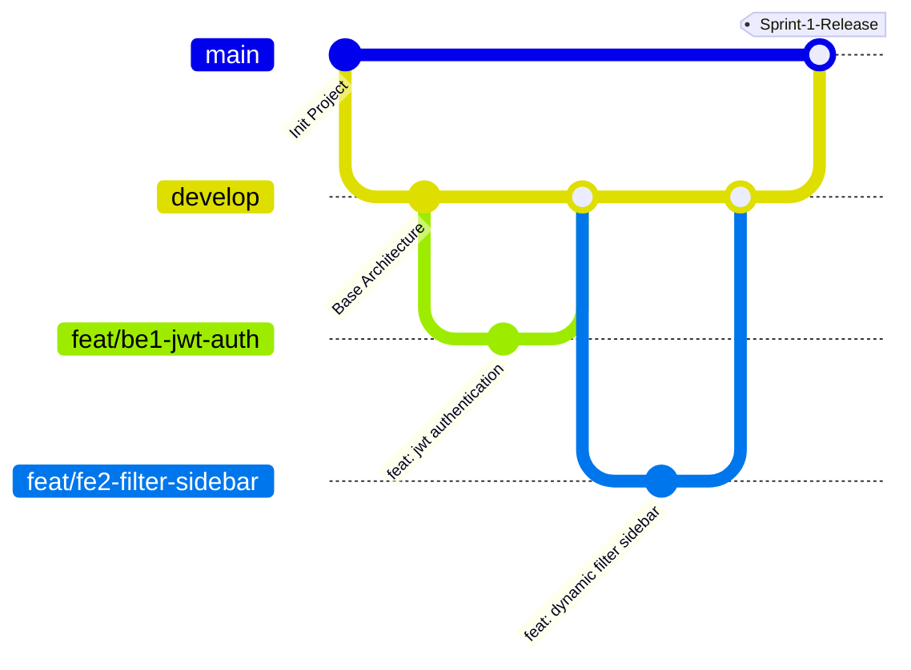

# 🌳 GREENPHONE - QUY CHUẨN GIT FLOW & QUY TRÌNH LÀM VIỆC DOANH NGHIỆP

> **Áp dụng cho:** Toàn bộ 6 thành viên nhóm GreenPhone  
> **Mục tiêu:** Tránh xung đột code (conflict), chuẩn hóa lịch sử commit và bảo vệ tuyệt đối nhánh Production trên máy chủ VPS.

---

## 📌 1. MÔ HÌNH PHÂN NHÁNH (GITFLOW ARCHITECTURE)



### Quy định về 3 cấp nhánh:
1. **`main` (Nhánh Production):**
   - Chạy trực tiếp trên VPS (`103.77.208.221`).
   - **TUYỆT ĐỐI CẤM commit hoặc push trực tiếp lên main.**
   - Chỉ được cập nhật thông qua Pull Request từ `develop` vào cuối mỗi Sprint khi code đã kiểm thử ổn định.
2. **`develop` (Nhánh Phát Triển Chung):**
   - Là nhánh gốc để cả 6 thành viên tách nhánh tính năng và merge code về đây.
3. **`feat/...` (Nhánh Tính Năng Cá Nhân):**
   - Tách ra từ `develop` khi nhận task trên Trello.
   - Tuân thủ cú pháp:
     - Backend: `feat/be<x>-<tên-chức-năng>` (VD: `feat/be1-jwt-auth`, `feat/be2-brand-catalog`, `feat/be3-sepay-qr`)
     - Frontend: `feat/fe<x>-<tên-chức-năng>` (VD: `feat/fe1-auth-pdp`, `feat/fe2-filter-sidebar`, `feat/fe3-cart-drawer`)
     - Sửa bug: `fix/<tên-lỗi>` (VD: `fix/stock-oversell-variant`)

---

## 📌 2. QUY TRÌNH LÀM VIỆC HÀNG NGÀY CỦA TỪNG THÀNH VIÊN (6 BƯỚC)

Khi bất kỳ thành viên nào bắt đầu làm việc trên máy tính cá nhân:

### Bước 1: Luôn đồng bộ nhánh `develop` mới nhất về máy
```bash
git checkout develop
git pull origin develop
```

### Bước 2: Tạo nhánh tính năng mới từ `develop`
*(Ví dụ bạn Phúc Thịnh nhận làm tính năng Upload Cloudinary)*
```bash
git checkout -b feat/be2-cloudinary-upload
```

### Bước 3: Code và Commit thường xuyên theo chuẩn Conventional Commits
Quy tắc đặt tên commit: `<loại_thay_đổi>(<phạm_vi>): <mô_tả_ngắn_gọn>`
- `feat(auth): add jwt login and token provider`
- `feat(catalog): add api filter by ram, storage and brand`
- `fix(cart): resolve quantity calculation error`
- `refactor(order): optimize pessimistic locking logic`
- `style(ui): format product detail page layout`

```bash
git add .
git commit -m "feat(catalog): implement brand and banner api"
```

### Bước 4: Kiểm tra và giải quyết conflict trước khi đẩy lên
Trước khi đẩy nhánh của mình lên GitHub, luôn kéo `develop` mới nhất và merge vào nhánh của mình:
```bash
# Cập nhật develop local
git checkout develop
git pull origin develop

# Quay lại nhánh của mình và merge develop vào
git checkout feat/be2-cloudinary-upload
git merge develop
```
*(Nếu có conflict, giải quyết ngay tại VS Code trên máy mình, chạy test đảm bảo không lỗi rồi commit).*

### Bước 5: Đẩy nhánh lên GitHub
```bash
git push -u origin feat/be2-cloudinary-upload
```

### Bước 6: Tạo Pull Request (PR) & Code Review
1. Truy cập GitHub repo: [https://github.com/nguyen0605/rikkei-ojt-greenphone-ecommerce](https://github.com/nguyen0605/rikkei-ojt-greenphone-ecommerce)
2. Bấm **Compare & pull request**:
   - **Base:** `develop` $\leftarrow$ **Compare:** `feat/be2-cloudinary-upload`
3. Đặt tiêu đề PR rõ ràng: `[BE2] API Quản lý Thương hiệu & Banner Khuyến Mãi`
4. Tag ít nhất **1 thành viên khác hoặc Tech Lead (nguyen0605)** vào mục **Reviewers**.
5. Khi có ít nhất **1 lượt Approve** mới được bấm **Merge pull request** vào `develop`.

---

## 📌 3. QUY TRÌNH RELEASE CUỐI SPRINT LÊN VPS (TECH LEAD THỰC HIỆN)

Khi kết thúc 1 tuần của Sprint và toàn bộ code trên `develop` đã kiểm thử thành công:

1. **Tạo PR:** `main` $\leftarrow$ `develop` trên GitHub.
2. Sau khi merge vào `main`, SSH vào VPS để cập nhật:
   ```bash
   ssh root@103.77.208.221
   
   cd /var/www/greenphone
   git pull origin main
   
   cd deploy
   docker compose -f docker-compose.prod.yml up -d --build
   ```
   Hệ thống trên VPS sẽ tự động cập nhật phiên bản mới nhất mà không làm gián đoạn database!
