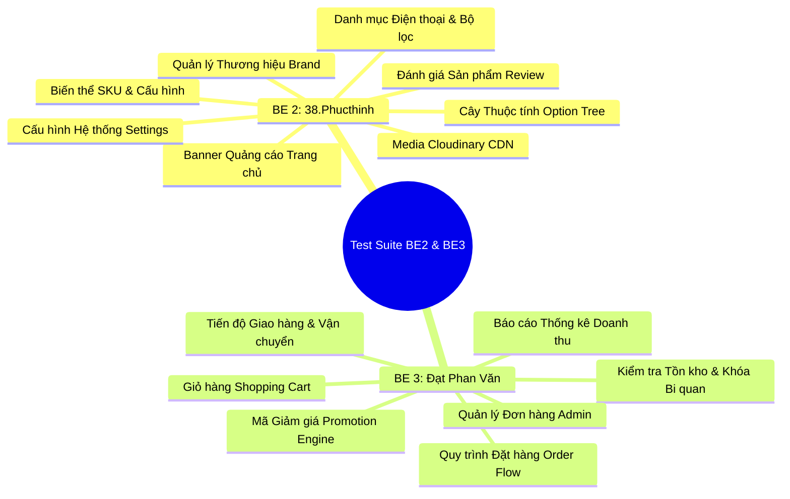

# GREENPHONE - KỊCH BẢN KIỂM THỬ BACKEND TOÀN DIỆN (BE2 & BE3)
> **Dự án:** GreenPhone - Hệ Thống Thương Mại Điện Tử Smartphone & Phụ Kiện Chính Hãng  
> **Phạm vi kiểm thử:** Toàn bộ API Backend của **BE 2 (38.Phucthinh)** và **BE 3 (Đạt Phan Văn)**  
> **Ngoại trừ:** Các task của Tech Lead **BE 1 (dangnguyen vu)** (Base Architecture, JWT Auth, User Profile, SePay Webhook, Email/OTP, Infra/Docker)  
> **Tệp Postman đính kèm:** `docs/postman_greenphone_BE2_BE3_test_suite.json` (90 test requests, 13 modules)

---

## I. TỔNG QUAN HỆ THỐNG & MÔI TRƯỜNG TEST

### 1. Môi Trường Thực Thi
- **Môi trường:** Local Development / Docker Test Environment
- **Base URL:** `http://localhost:8080`
- **Chuẩn dữ liệu phản hồi (Response Format):** 100% API tuân thủ cấu trúc `ApiResponse<T>`:
  ```json
  {
    "code": 200,
    "message": "Success",
    "data": { ... },
    "timestamp": 1730250000000
  }
  ```

### 2. Danh Sách Tài Khoản Kiểm Thử
| Vai trò | Email đăng nhập | Mật khẩu | Mục đích sử dụng |
| :--- | :--- | :--- | :--- |
| **Quản trị viên (ADMIN)** | `admin@greenphone.vn` | `admin123` | Thực thi các API CRUD danh mục, duyệt review, xử lý đơn hàng, xem thống kê |
| **Khách hàng (CUSTOMER)** | `an.nguyen@example.com` | `password123` | Thực thi các API giỏ hàng, claim voucher, đặt đơn hàng, gửi đánh giá máy |

---

## II. MA TRẬN PHÂN CHIA NHIỆM VỤ & PHẠM VI KIỂM THỬ



---

## III. KỊCH BẢN KIỂM THỬ CHI TIẾT - BE 2: 38.Phucthinh

### Module 1: Quản Lý Thương Hiệu (Brand Management)
- **Tập tin source:** `controller/BrandController.java`, `controller/admin/AdminBrandController.java`, `service/BrandService.java`

| Mã TC | Tên kịch bản | Method & Endpoint | Quyền hạn | Dữ liệu đầu vào (Payload / Query) | Kết quả mong đợi (Expected Result) |
| :--- | :--- | :--- | :--- | :--- | :--- |
| **TC_BE2_BR01** | Lấy danh sách thương hiệu đang hoạt động | `GET /api/brands` | Public | Không | HTTP 200, trả về danh sách các hãng Apple, Samsung, Xiaomi,... kèm logo SVG |
| **TC_BE2_BR02** | Xem danh sách thương hiệu phía Admin (có phân trang & tìm kiếm) | `GET /api/admin/brands` | ADMIN | `?keyword=Apple&page=0&size=10` | HTTP 200, trả về phân trang DTO chứa các nhãn hàng khớp từ khóa tìm kiếm |
| **TC_BE2_BR03** | Thêm mới thương hiệu thành công | `POST /api/admin/brands` | ADMIN | `{"name": "Nothing Phone", "logoUrl": "https://res.cloudinary.com/logo.png"}` | HTTP 201 Created, thương hiệu mới được tạo và sinh `id` |
| **TC_BE2_BR04** | Thêm mới thương hiệu thất bại do tên rỗng | `POST /api/admin/brands` | ADMIN | `{"name": "", "logoUrl": "..."}` | HTTP 400 Bad Request, trả về message `Brand name is required` |
| **TC_BE2_BR05** | Cập nhật thông tin thương hiệu | `PUT /api/admin/brands/{id}` | ADMIN | `{"name": "Nothing Phone Global", "logoUrl": "..."}` | HTTP 200 OK, thông tin tên hãng được cập nhật |
| **TC_BE2_BR06** | Đổi trạng thái hiển thị thương hiệu | `PUT /api/admin/brands/{id}/status` | ADMIN | `{"status": "INACTIVE"}` | HTTP 200 OK, trạng thái chuyển sang INACTIVE |
| **TC_BE2_BR07** | Xóa thương hiệu | `DELETE /api/admin/brands/{id}` | ADMIN | `{id}` vừa tạo | HTTP 200 OK, message `Brand deleted` |
| **TC_BE2_BR08** | Bảo mật API: Chặn truy cập không có token Admin | `GET /api/admin/brands` | Guest | Không gửi Header Authorization | HTTP 401 Unauthorized hoặc HTTP 403 Forbidden |

---

### Module 2: Quản Lý Banner Trang Chủ (Banner Management)
- **Tập tin source:** `controller/BannerController.java`, `controller/admin/AdminBannerController.java`

| Mã TC | Tên kịch bản | Method & Endpoint | Quyền hạn | Dữ liệu đầu vào | Kết quả mong đợi |
| :--- | :--- | :--- | :--- | :--- | :--- |
| **TC_BE2_BN01** | Lấy danh sách banner kích hoạt trên trang chủ | `GET /api/banners` | Public | Không | HTTP 200 OK, trả về danh sách banner active hiển thị trên slider |
| **TC_BE2_BN02** | Quản lý danh sách toàn bộ banner | `GET /api/admin/banners` | ADMIN | `?page=0&size=10` | HTTP 200 OK, danh sách banner phân trang |
| **TC_BE2_BN03** | Tạo banner khuyến mãi mới | `POST /api/admin/banners` | ADMIN | `{"title": "Mở bán iPhone 16", "imageUrl": "https://.../banner.webp", "linkUrl": "/products"}` | HTTP 201 Created, banner được thêm vào hệ thống |
| **TC_BE2_BN04** | Tạo banner thất bại do thiếu URL ảnh | `POST /api/admin/banners` | ADMIN | `{"title": "Thiếu ảnh", "imageUrl": ""}` | HTTP 400 Bad Request, báo lỗi validation `@NotBlank` |
| **TC_BE2_BN05** | Cập nhật banner | `PUT /api/admin/banners/{id}` | ADMIN | `{"title": "Đại tiệc công nghệ", "imageUrl": "..."}` | HTTP 200 OK, banner được chỉnh sửa |
| **TC_BE2_BN06** | Xóa banner quảng cáo | `DELETE /api/admin/banners/{id}` | ADMIN | `{id}` banner | HTTP 200 OK, xóa thành công |

---

### Module 3: Cây Thuộc Tính & Thông Số Kỹ Thuật (Option & OptionItem Tree)
- **Tập tin source:** `controller/OptionController.java`, `controller/admin/AdminOptionController.java`, `service/OptionService.java`

| Mã TC | Tên kịch bản | Method & Endpoint | Quyền hạn | Dữ liệu đầu vào | Kết quả mong đợi |
| :--- | :--- | :--- | :--- | :--- | :--- |
| **TC_BE2_OP01** | Lấy toàn bộ cây thuộc tính thông số (Option Tree) | `GET /api/options` | Public | Không | HTTP 200 OK, trả về danh mục cây: RAM, Storage, Color, Features |
| **TC_BE2_OP02** | Xem danh sách nhóm thuộc tính (Categories) | `GET /api/admin/options` | ADMIN | Không | HTTP 200 OK, danh sách các loại option cha |
| **TC_BE2_OP03** | Lấy danh sách enum loại Option Types | `GET /api/admin/options/types` | ADMIN | Không | HTTP 200 OK, trả về danh sách các type hợp lệ |
| **TC_BE2_OP04** | Tạo nhóm thuộc tính mới (Category) | `POST /api/admin/options` | ADMIN | `{"type": "FEATURE", "label": "Kháng Nước", "enabled": true, "maxItems": 10}` | HTTP 201 Created, sinh `option_id` |
| **TC_BE2_OP05** | Cập nhật nhóm thuộc tính | `PUT /api/admin/options/{id}` | ADMIN | `{"type": "FEATURE", "label": "Chuẩn Kháng Nước IP68", ...}` | HTTP 200 OK, nhãn option được đổi mới |
| **TC_BE2_OP06** | Lấy danh sách giá trị con (OptionItems) theo nhóm | `GET /api/admin/options/{optionId}/items` | ADMIN | `{optionId}` | HTTP 200 OK, trả về danh sách item con |
| **TC_BE2_OP07** | Thêm giá trị con vào nhóm thuộc tính | `POST /api/admin/options/{optionId}/items` | ADMIN | `{"value": "IP68 Chống Nước 6m", "sortOrder": 1}` | HTTP 201 Created, tạo thành công OptionItem |
| **TC_BE2_OP08** | Cập nhật giá trị thuộc tính con | `PUT /api/admin/options/items/{id}` | ADMIN | `{"value": "IP68 Tiêu Chuẩn Quân Đội", ...}` | HTTP 200 OK |
| **TC_BE2_OP09** | Kiểm tra mức độ sử dụng của OptionItem | `GET /api/admin/options/items/{id}/usage` | ADMIN | `{id}` của OptionItem | HTTP 200 OK, trả về số lượng máy đang dùng |
| **TC_BE2_OP10** | Xóa giá trị thuộc tính con | `DELETE /api/admin/options/items/{id}` | ADMIN | `{id}` OptionItem | HTTP 200 OK |
| **TC_BE2_OP11** | Xóa nhóm thuộc tính cha | `DELETE /api/admin/options/{id}` | ADMIN | `{id}` Option | HTTP 200 OK |

---

### Module 4: Danh Mục Điện Thoại, Bộ Lọc Đa Tiêu Chí & Biến Thể SKU
- **Tập tin source:** `controller/PhoneController.java`, `controller/admin/AdminPhoneController.java`, `service/PhoneService.java`

| Mã TC | Tên kịch bản | Method & Endpoint | Quyền hạn | Dữ liệu đầu vào | Kết quả mong đợi |
| :--- | :--- | :--- | :--- | :--- | :--- |
| **TC_BE2_PH01** | Lấy danh sách điện thoại phân trang | `GET /api/phones` | Public | `?page=0&size=10` | HTTP 200 OK, trả về mảng phones kèm variants và giá thấp nhất |
| **TC_BE2_PH02** | Lọc điện thoại đa tiêu chí (Hãng + Giá + RAM) | `GET /api/phones` | Public | `?brandIds=1&minPrice=10000000&maxPrice=35000000&rams=8GB` | HTTP 200 OK, kết quả lọc chính xác theo các tiêu chí kết hợp |
| **TC_BE2_PH03** | Lấy chi tiết điện thoại thành công | `GET /api/phones/{id}` | Public | `{id}: 1` | HTTP 200 OK, trả về tên máy, thông số, danh sách biến thể màu/ROM |
| **TC_BE2_PH04** | Lấy chi tiết điện thoại thất bại (ID không tồn tại) | `GET /api/phones/999999` | Public | `{id}: 999999` | HTTP 404 Not Found, không gây crash server |
| **TC_BE2_PH05** | Tìm kiếm điện thoại theo từ khóa | `GET /api/phones/search` | Public | `?q=iPhone` | HTTP 200 OK, trả về các dòng iPhone |
| **TC_BE2_PH06** | Lấy dữ liệu metadata bộ lọc động | `GET /api/phones/filters` | Public | Không | HTTP 200 OK, trả về minPrice, maxPrice, danh sách nhãn hiệu và cấu hình |
| **TC_BE2_PH07** | Xem danh sách điện thoại phía Admin | `GET /api/admin/phones` | ADMIN | `?keyword=Galaxy&page=0&size=10` | HTTP 200 OK, danh sách sản phẩm quản trị |
| **TC_BE2_PH08** | Xem chi tiết máy phía Admin | `GET /api/admin/phones/{id}` | ADMIN | `{id}: 1` | HTTP 200 OK, đầy đủ thông tin quản trị nội bộ |
| **TC_BE2_PH09** | Tạo mới điện thoại kèm thông số kỹ thuật | `POST /api/admin/phones` | ADMIN | JSON chứa brandId, name, screen, chip, camera, battery, warranty | HTTP 201 Created, tạo thành công điện thoại mới |
| **TC_BE2_PH10** | Cập nhật thông số kỹ thuật điện thoại | `PUT /api/admin/phones/{id}` | ADMIN | Payload cập nhật màn hình, chip, pin | HTTP 200 OK |
| **TC_BE2_PH11** | Đổi trạng thái điện thoại (PUBLISHED / HIDDEN) | `PUT /api/admin/phones/{id}/status` | ADMIN | `{"status": "PUBLISHED"}` | HTTP 200 OK |
| **TC_BE2_PH12** | Xem danh sách biến thể của điện thoại | `GET /api/admin/phones/{id}/variants` | ADMIN | `{phoneId}: 1` | HTTP 200 OK, trả về danh sách các biến thể RAM/ROM/Màu kèm tồn kho |
| **TC_BE2_PH13** | Thêm biến thể SKU mới cho máy | `POST /api/admin/phones/{id}/variants` | ADMIN | JSON chứa ramItemId, storageItemId, colorItemId, price, stockQuantity, sku | HTTP 201 Created, biến thể mới được tạo kèm mã SKU |
| **TC_BE2_PH14** | Cập nhật giá bán & số lượng tồn kho của biến thể | `PUT /api/admin/phones/{id}/variants/{vId}` | ADMIN | `{"price": 27990000, "stockQuantity": 100, ...}` | HTTP 200 OK, giá và kho được cập nhật |
| **TC_BE2_PH15** | Xóa biến thể | `DELETE /api/admin/phones/{id}/variants/{vId}` | ADMIN | `{variantId}` | HTTP 200 OK |
| **TC_BE2_PH16** | Xóa điện thoại | `DELETE /api/admin/phones/{id}` | ADMIN | `{id}` điện thoại | HTTP 200 OK |

---

### Module 5: Media Cloudinary & Thư Viện Ảnh Điện Thoại
- **Tập tin source:** `service/CloudinaryService.java`, `controller/admin/AdminPhoneController.java`

| Mã TC | Tên kịch bản | Method & Endpoint | Quyền hạn | Dữ liệu đầu vào | Kết quả mong đợi |
| :--- | :--- | :--- | :--- | :--- | :--- |
| **TC_BE2_MED01** | Lấy danh sách hình ảnh của điện thoại | `GET /api/admin/phones/{id}/images` | ADMIN | `{phoneId}: 1` | HTTP 200 OK, trả về danh sách ảnh Cloudinary CDN URL |
| **TC_BE2_MED02** | Sắp xếp lại thứ tự ảnh hiển thị (Reorder) | `PUT /api/admin/phones/{id}/images/reorder` | ADMIN | `{"imageIds": [1, 2]}` | HTTP 200 OK, thứ tự ảnh được cập nhật |
| **TC_BE2_MED03** | Cập nhật metadata hình ảnh (isPrimary/caption) | `PUT /api/admin/phones/{id}/images/{imgId}` | ADMIN | `{"isPrimary": true, "caption": "Ảnh mặt trước"}` | HTTP 200 OK |
| **TC_BE2_MED04** | Xóa hình ảnh sản phẩm thất bại khi ID không tồn tại | `DELETE /api/admin/phones/{id}/images/999999` | ADMIN | ID 999999 | HTTP 404 Not Found |

---

### Module 6: Đánh Giá Sản Phẩm (Reviews & Ratings Service)
- **Tập tin source:** `controller/ReviewController.java`, `controller/admin/AdminReviewController.java`, `service/ReviewService.java`

| Mã TC | Tên kịch bản | Method & Endpoint | Quyền hạn | Dữ liệu đầu vào | Kết quả mong đợi |
| :--- | :--- | :--- | :--- | :--- | :--- |
| **TC_BE2_REV01** | Lấy danh sách đánh giá của sản phẩm | `GET /api/reviews/phone/{id}` | Public | `{phoneId}: 1` | HTTP 200 OK, danh sách đánh giá đã duyệt |
| **TC_BE2_REV02** | Lấy thống kê số sao trung bình & phân bổ rating | `GET /api/reviews/phone/{id}/summary` | Public | `{phoneId}: 1` | HTTP 200 OK, trả về `averageRating`, `totalReviews`, `star1` - `star5` |
| **TC_BE2_REV03** | Lấy danh sách sản phẩm đủ điều kiện đánh giá (đã mua) | `GET /api/reviews/eligible` | CUSTOMER | Header Bearer Token | HTTP 200 OK, chỉ các đơn hàng thành công mới được đánh giá |
| **TC_BE2_REV04** | Xem lịch sử đánh giá của bản thân | `GET /api/reviews/me` | CUSTOMER | Header Bearer Token | HTTP 200 OK |
| **TC_BE2_REV05** | Gửi đánh giá thất bại do số sao không hợp lệ (Rating = 6) | `POST /api/reviews` | CUSTOMER | `{"orderDetailId": 1, "rating": 6, "content": "Tốt"}` | HTTP 400 Bad Request, message `Rating must be 1-5` |
| **TC_BE2_REV06** | Xem danh sách đánh giá cần kiểm duyệt | `GET /api/admin/reviews` | ADMIN | `?page=0&size=10` | HTTP 200 OK, danh sách đánh giá toàn sàn |
| **TC_BE2_REV07** | Phê duyệt/Ẩn đánh giá | `PUT /api/admin/reviews/{id}/status` | ADMIN | `{"status": "APPROVED"}` | HTTP 200 OK, trạng thái review chuyển sang APPROVED |

---

### Module 7: Cài Đặt Hệ Thống Cửa Hàng (System Settings API)
- **Tập tin source:** `controller/SettingsController.java`, `controller/admin/AdminSettingsController.java`, `service/SettingsService.java`

| Mã TC | Tên kịch bản | Method & Endpoint | Quyền hạn | Dữ liệu đầu vào | Kết quả mong đợi |
| :--- | :--- | :--- | :--- | :--- | :--- |
| **TC_BE2_SET01** | Lấy thông tin cấu hình cửa hàng công khai | `GET /api/settings` | Public | Không | HTTP 200 OK, trả về map key-value: hotline, email, phí ship, địa chỉ |
| **TC_BE2_SET02** | Xem toàn bộ cấu hình hệ thống phía Admin | `GET /api/admin/settings` | ADMIN | Header Admin Token | HTTP 200 OK, danh sách settings đầy đủ |
| **TC_BE2_SET03** | Cập nhật cấu hình cửa hàng | `PUT /api/admin/settings` | ADMIN | `{"shop_hotline": "1900 6868", "shop_shipping_fee": "30000"}` | HTTP 200 OK, dữ liệu mới được lưu thành công |

---

## IV. KỊCH BẢN KIỂM THỬ CHI TIẾT - BE 3: Đạt Phan Văn

### Module 8: Mã Giảm Giá & Voucher Engine (Promotion Service)
- **Tập tin source:** `controller/PromotionController.java`, `controller/admin/AdminPromotionController.java`, `service/PromotionService.java`

| Mã TC | Tên kịch bản | Method & Endpoint | Quyền hạn | Dữ liệu đầu vào | Kết quả mong đợi |
| :--- | :--- | :--- | :--- | :--- | :--- |
| **TC_BE3_PR01** | Xem danh sách mã khuyến mãi đang active công khai | `GET /api/promotions/public` | Public | Không | HTTP 200 OK, chỉ trả về các voucher còn hạn và trạng thái ACTIVE |
| **TC_BE3_PR02** | Lấy danh sách voucher khả dụng theo giá trị giỏ hàng | `GET /api/promotions/available` | CUSTOMER | `?orderAmount=15000000` | HTTP 200 OK, lọc các voucher có `minOrderValue <= 15.000.000đ` |
| **TC_BE3_PR03** | Xem ví voucher cá nhân của khách hàng | `GET /api/promotions/me` | CUSTOMER | Header Customer Token | HTTP 200 OK, trả về các voucher khách đã claim |
| **TC_BE3_PR04** | Claim voucher thất bại khi nhập mã không tồn tại | `POST /api/promotions/claim` | CUSTOMER | `{"code": "KHONG_TON_TAI"}` | HTTP 400 hoặc 404, báo lỗi voucher không hợp lệ |
| **TC_BE3_PR05** | Xem toàn bộ voucher quản trị | `GET /api/admin/promotions` | ADMIN | `?page=0&size=10` | HTTP 200 OK, danh sách voucher phân trang |
| **TC_BE3_PR06** | Xem chi tiết 1 voucher | `GET /api/admin/promotions/1` | ADMIN | `{id}: 1` | HTTP 200 OK, chi tiết voucher kèm số lượt dùng |
| **TC_BE3_PR07** | Tạo mới mã voucher giảm giá tiền mặt (FIXED_AMOUNT) | `POST /api/admin/promotions` | ADMIN | JSON code, discountType=FIXED_AMOUNT, discountValue=200000, minOrderValue, dates | HTTP 201 Created, voucher được tạo |
| **TC_BE3_PR08** | Tạo voucher thất bại do thiếu mã code bắt buộc | `POST /api/admin/promotions` | ADMIN | `{"code": "", ...}` | HTTP 400 Bad Request, message `Promotion code is required` |
| **TC_BE3_PR09** | Cập nhật thông tin voucher | `PUT /api/admin/promotions/{id}` | ADMIN | Payload cập nhật hạn dùng, giá trị | HTTP 200 OK |
| **TC_BE3_PR10** | Xóa/ngừng voucher | `DELETE /api/admin/promotions/{id}` | ADMIN | `{id}` voucher | HTTP 200 OK |

---

### Module 9: Giỏ Hàng Mua Sắm (Shopping Cart Service)
- **Tập tin source:** `controller/CartController.java`, `service/CartService.java`

| Mã TC | Tên kịch bản | Method & Endpoint | Quyền hạn | Dữ liệu đầu vào | Kết quả mong đợi |
| :--- | :--- | :--- | :--- | :--- | :--- |
| **TC_BE3_CT01** | Lấy thông tin giỏ hàng hiện tại | `GET /api/cart` | CUSTOMER | Header Customer Token | HTTP 200 OK, trả về mảng items, tổng số lượng và `totalAmount` tự tính |
| **TC_BE3_CT02** | Thêm sản phẩm biến thể vào giỏ hàng | `POST /api/cart/items` | CUSTOMER | `{"phoneVariantId": 1, "quantity": 1}` | HTTP 200 OK, thêm item thành công, sinh `cart_item_id` |
| **TC_BE3_CT03** | Thêm vào giỏ thất bại do biến thể không tồn tại | `POST /api/cart/items` | CUSTOMER | `{"phoneVariantId": 999999, "quantity": 1}` | HTTP 404 Not Found |
| **TC_BE3_CT04** | Thêm vào giỏ thất bại do số lượng <= 0 | `POST /api/cart/items` | CUSTOMER | `{"phoneVariantId": 1, "quantity": 0}` | HTTP 400 Bad Request, message `Quantity must be at least 1` |
| **TC_BE3_CT05** | Cập nhật số lượng sản phẩm trong giỏ | `PUT /api/cart/items/{id}` | CUSTOMER | `{"quantity": 2}` | HTTP 200 OK, số lượng tăng lên 2, tổng tiền tăng tương ứng |
| **TC_BE3_CT06** | Xóa 1 sản phẩm khỏi giỏ hàng | `DELETE /api/cart/items/{id}` | CUSTOMER | `{itemId}` | HTTP 200 OK, item bị xóa khỏi giỏ |
| **TC_BE3_CT07** | Dọn sạch toàn bộ giỏ hàng (Clear Cart) | `DELETE /api/cart` | CUSTOMER | Không | HTTP 200 OK, giỏ hàng reset về rỗng |

---

### Module 10: Quy Trình Đặt Hàng & Khóa Tồn Kho Chống Bán Âm (Order Flow & Concurrency Lock)
- **Tập tin source:** `controller/OrderController.java`, `service/OrderService.java`, `repository/PhoneVariantRepository.java`

| Mã TC | Tên kịch bản | Method & Endpoint | Quyền hạn | Dữ liệu đầu vào | Kết quả mong đợi |
| :--- | :--- | :--- | :--- | :--- | :--- |
| **TC_BE3_ORD01** | Đặt hàng thành công phương thức COD | `POST /api/orders` | CUSTOMER | JSON receiverName, receiverPhone, shippingAddress, paymentMethod="COD", items | HTTP 201 Created, sinh mã đơn `orderCode`, trạng thái đơn là `PENDING`, tồn kho bị trừ ngay lập tức |
| **TC_BE3_ORD02** | Đặt hàng thất bại do thiếu địa chỉ & số điện thoại | `POST /api/orders` | CUSTOMER | JSON để rỗng thông tin người nhận | HTTP 400 Bad Request, trả về chi tiết lỗi validate |
| **TC_BE3_ORD03** | Lấy danh sách đơn hàng của khách hàng | `GET /api/orders` | CUSTOMER | `?page=0&size=10` | HTTP 200 OK, danh sách đơn hàng của chính user đang đăng nhập |
| **TC_BE3_ORD04** | Xem chi tiết đơn hàng vừa tạo | `GET /api/orders/{id}` | CUSTOMER | `{id}` đơn hàng vừa tạo | HTTP 200 OK, trả về chi tiết đơn, sản phẩm mua, giá trị và địa chỉ |
| **TC_BE3_ORD05** | Khách hủy đơn hàng khi đang PENDING & Hoàn tồn kho | `PUT /api/orders/{id}/cancel` | CUSTOMER | `{id}` đơn hàng | HTTP 200 OK, trạng thái đơn chuyển `CANCELLED`, số lượng tồn kho của biến thể được cộng hoàn trả lại |
| **TC_BE3_ORD06** | Hủy đơn hàng thất bại khi ID không tồn tại | `PUT /api/orders/999999/cancel` | CUSTOMER | ID 999999 | HTTP 404 Not Found |
| **TC_BE3_ORD07** | Xem lịch sử đơn hàng đã giao thành công | `GET /api/orders/history` | CUSTOMER | `?page=0&size=10` | HTTP 200 OK |

---

### Module 11: Quản Lý Đơn Hàng Phía Quản Trị & Tiến Độ Vận Chuyển (Admin Order Management)
- **Tập tin source:** `controller/admin/AdminOrderController.java`, `service/admin/AdminOrderService.java`

| Mã TC | Tên kịch bản | Method & Endpoint | Quyền hạn | Dữ liệu đầu vào | Kết quả mong đợi |
| :--- | :--- | :--- | :--- | :--- | :--- |
| **TC_BE3_AORD01** | Xem danh sách toàn bộ đơn hàng lọc theo PENDING | `GET /api/admin/orders` | ADMIN | `?status=PENDING&page=0&size=10` | HTTP 200 OK, trả về các đơn đang chờ duyệt |
| **TC_BE3_AORD02** | Xem chi tiết đơn hàng phía Admin | `GET /api/admin/orders/{id}` | ADMIN | `{id}: 1` | HTTP 200 OK, thông tin khách, địa chỉ, đơn giá, mã thanh toán |
| **TC_BE3_AORD03** | Cập nhật tiến độ giao hàng sang IN_TRANSIT | `PUT /api/admin/orders/{id}/delivery` | ADMIN | `{"status": "IN_TRANSIT"}` | HTTP 200 OK, trạng thái vận chuyển cập nhật |
| **TC_BE3_AORD04** | Cập nhật trạng thái thanh toán sang PAID | `PUT /api/admin/orders/{id}/payment-status` | ADMIN | `{"paymentStatus": "PAID"}` | HTTP 200 OK, đơn được xác nhận đã thanh toán |
| **TC_BE3_AORD05** | Cập nhật trạng thái tổng thể đơn sang SHIPPING | `PUT /api/admin/orders/{id}/status` | ADMIN | `{"status": "SHIPPING"}` | HTTP 200 OK, trạng thái đơn chuyển sang Đang giao hàng |

---

### Module 12: Báo Cáo Thống Kê & Phân Tích Doanh Thu (Admin Statistics Service)
- **Tập tin source:** `controller/admin/AdminStatisticsController.java`, `service/admin/AdminStatisticsService.java`

| Mã TC | Tên kịch bản | Method & Endpoint | Quyền hạn | Dữ liệu đầu vào | Kết quả mong đợi |
| :--- | :--- | :--- | :--- | :--- | :--- |
| **TC_BE3_STAT01** | Báo cáo doanh thu theo tháng | `GET /api/admin/statistics/revenue` | ADMIN | `?period=month` | HTTP 200 OK, trả về chuỗi doanh thu theo các tháng |
| **TC_BE3_STAT02** | Báo cáo doanh thu theo ngày | `GET /api/admin/statistics/revenue` | ADMIN | `?period=day` | HTTP 200 OK, biểu đồ doanh thu chi tiết theo ngày |
| **TC_BE3_STAT03** | Thống kê số lượng đơn hàng theo trạng thái | `GET /api/admin/statistics/orders` | ADMIN | Không | HTTP 200 OK, số lượng đơn PENDING, CONFIRMED, COMPLETED, CANCELLED |
| **TC_BE3_STAT04** | Bảng xếp hạng Top smartphone bán chạy nhất | `GET /api/admin/statistics/top-selling` | ADMIN | `?limit=5` | HTTP 200 OK, danh sách 5 máy có doanh số và số lượng bán cao nhất |

---

## V. HƯỚNG DẪN IMPORT VÀ THỰC THI POSTMAN COLLECTION

1. **Vị trí file Collection:**
   `docs/postman_greenphone_BE2_BE3_test_suite.json`

2. **Các bước Import vào Postman:**
   - Bước 1: Mở ứng dụng **Postman**.
   - Bước 2: Chọn nút **Import** ở góc trên cùng bên trái.
   - Bước 3: Kéo thả file `postman_greenphone_BE2_BE3_test_suite.json` hoặc duyệt tới đường dẫn `GreenPhone/docs/postman_greenphone_BE2_BE3_test_suite.json`.
   - Bước 4: Bấm **Import**. Bạn sẽ thấy Collection mang tên:
     `GreenPhone - BE2 & BE3 Full Backend Test Suite (Excluding BE1 Leader)` gồm **13 thư mục** và **90 requests**.

3. **Thứ tự thực thi tự động (Collection Runner):**
   - Chạy thư mục `00. Auth Helpers (Trích xuất Token Tự động)` đầu tiên:
     - Request `0.1 Đăng nhập Admin` sẽ tự động trích xuất Bearer Token và gán vào biến collection `{{token_admin}}`.
     - Request `0.2 Đăng nhập Customer` sẽ tự động trích xuất Bearer Token và gán vào biến collection `{{token_customer}}`.
   - Sau đó chọn toàn bộ Collection và bấm **Run Collection**. Tất cả các request CRUD tiếp theo sẽ tự động lấy token và truyền `id` động giữa các bước (tạo brand -> lấy id -> update -> xóa; tạo order -> lấy id -> cập nhật vận chuyển).
