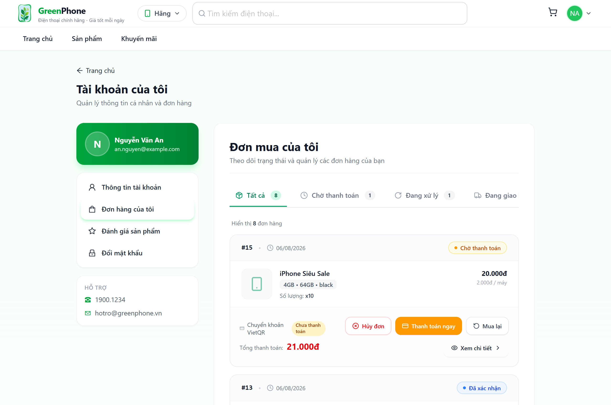
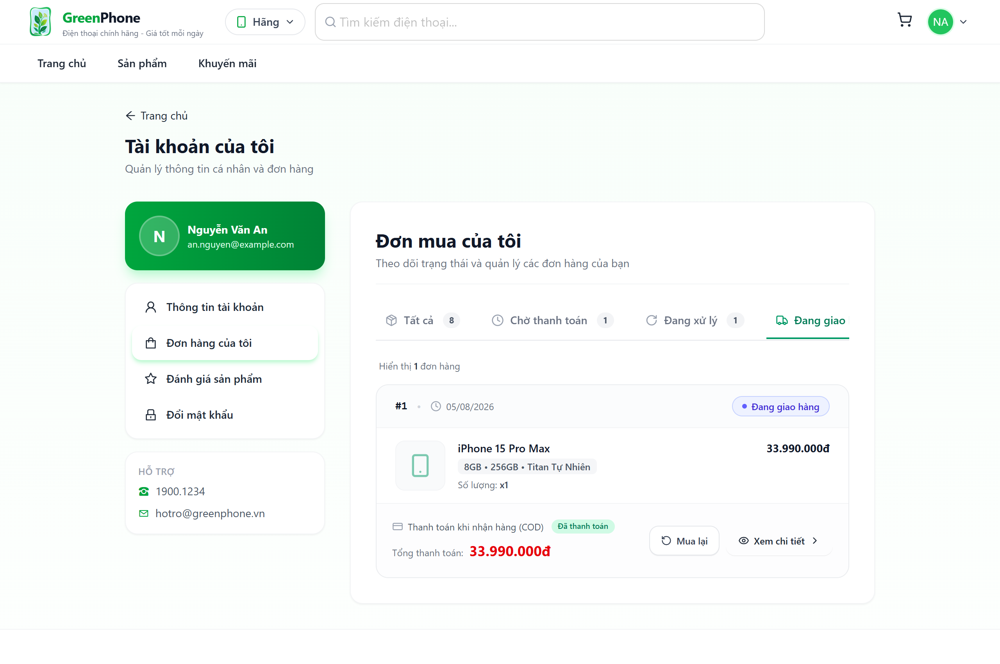
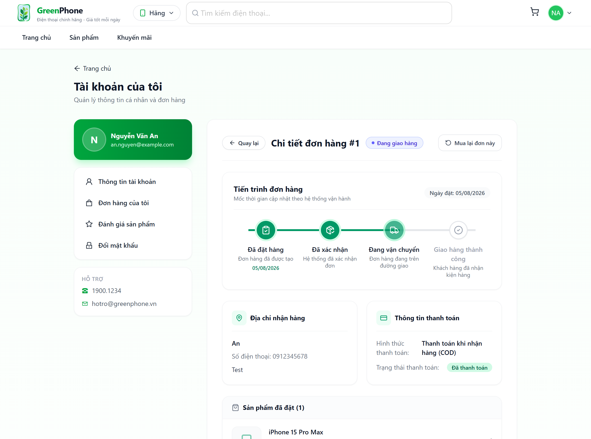
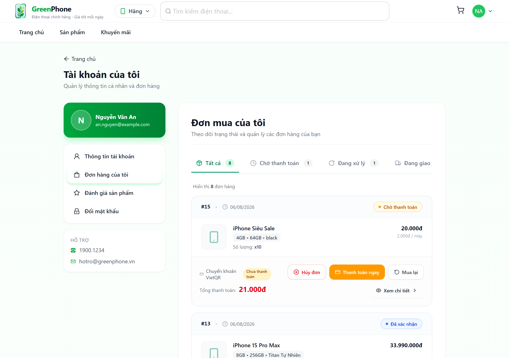
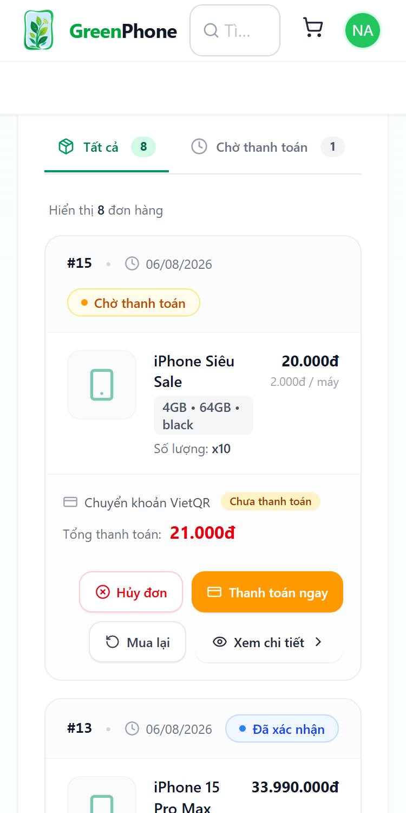
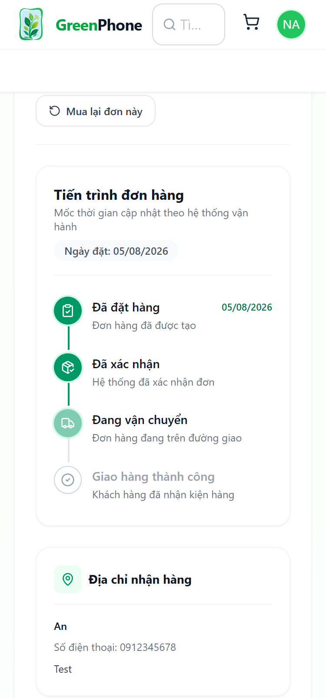

# Báo Cáo Triển Khai: [2 SP] [FE2] Giao Diện Tra Cứu & Lịch Sử Mua Hàng (Order History & Tracking)

---

## 1. Thông Tin Task

- **Tên Task:** `[2 SP] [FE2] Giao Diện Tra Cứu & Lịch Sử Mua Hàng (Order History & Tracking)`
- **Dự án:** GreenPhone Ecommerce
- **Nhánh Git:** `feat/fe2-order-history-tracking`
- **Phạm vi triển khai:**
  - Hoàn thiện toàn bộ khu vực tra cứu lịch sử mua hàng khách hàng trong `AccountLayout`.
  - Bộ lọc trạng thái đơn hàng (Tất cả, Chờ thanh toán, Đang xử lý, Đang giao hàng, Đã giao, Đã hủy) đồng bộ query param URL.
  - Card đơn hàng `OrderCard` chuẩn thương mại điện tử hiện đại.
  - Stepper `OrderTrackingTimeline` 4 bước chuẩn hóa tiến trình vận đơn và trạng thái hủy đơn riêng biệt.
  - Bộ nút hành động thông minh theo điều kiện trạng thái nghiệp vụ (Hủy đơn, Thanh toán ngay, Mua lại, Viết đánh giá).
  - Tách riêng module `orderService.ts` chuẩn REST API client.
- **Danh sách file tạo mới / chỉnh sửa:**
  - `Frontend/src/services/orderService.ts` *(Tạo mới)*
  - `Frontend/src/services/index.ts` *(Chỉnh sửa - re-export orderService)*
  - `Frontend/src/components/order/orderHelpers.ts` *(Tạo mới)*
  - `Frontend/src/components/order/OrderCard.tsx` *(Tạo mới)*
  - `Frontend/src/components/order/OrderTrackingTimeline.tsx` *(Tạo mới)*
  - `Frontend/src/components/order/OrderCancelModal.tsx` *(Tạo mới)*
  - `Frontend/src/pages/account/OrderHistoryPage.tsx` *(Tạo mới)*
  - `Frontend/src/pages/account/OrderDetailPage.tsx` *(Tạo mới)*
  - `Frontend/src/pages/account/AccountOrdersPage.tsx` *(Chỉnh sửa - kết nối OrderHistoryPage)*
  - `Frontend/src/pages/account/AccountOrderDetailPage.tsx` *(Chỉnh sửa - kết nối OrderDetailPage)*
  - `Frontend/src/services/__tests__/orderService.test.ts` *(Tạo mới)*
  - `Frontend/src/components/order/__tests__/OrderCard.test.tsx` *(Tạo mới)*
  - `Frontend/src/components/order/__tests__/OrderTrackingTimeline.test.tsx` *(Tạo mới)*
  - `Frontend/src/pages/account/__tests__/OrderHistoryPage.test.tsx` *(Tạo mới)*
  - `Frontend/src/pages/account/__tests__/OrderDetailPage.test.tsx` *(Tạo mới)*
  - `scripts/capture-order-evidence.cjs` *(Tạo mới)*
  - `docs/evidence/fe2-order-history/REPORT.md` *(Tạo mới)*

---

## 2. Tóm Tắt Chức Năng

### 2.1. Thanh Tab Trạng Thái Đơn Hàng (Status Tabs)
- Bao gồm 6 tab chuẩn hóa:
  1. **Tất cả (`all`):** Hiển thị toàn bộ đơn hàng của khách hàng.
  2. **Chờ thanh toán (`pending`):** Các đơn hàng vừa tạo, chưa thanh toán qua cổng VietQR/Sepay.
  3. **Đang xử lý (`processing`):** Các đơn hàng đã được hệ thống xác nhận (`CONFIRMED`) hoặc đang đóng gói (`PROCESSING`).
  4. **Đang giao hàng (`shipping`):** Các đơn hàng đã bàn giao cho đơn vị vận chuyển (`SHIPPING`).
  5. **Đã giao (`delivered`):** Các đơn hàng đã giao thành công tới tay khách hàng (`DELIVERED`).
  6. **Đã hủy (`cancelled`):** Các đơn hàng đã hủy bởi khách hàng hoặc quản trị viên (`CANCELLED`).
- **Cơ chế URL Query Parameter:** Đồng bộ trực tiếp với `?status=...`. Hỗ trợ phím Back/Forward của trình duyệt, không reload trang, tự động ghi nhớ bộ lọc khi xem chi tiết và quay lại danh sách.
- **Badge số lượng:** Hiển thị số lượng đơn hàng tương ứng theo từng trạng thái.

### 2.2. Card Đơn Hàng (OrderCard)
- **Header:** Mã đơn hàng dạng `#15`, ngày tạo đơn chuẩn định dạng Việt Nam, badge trạng thái bo góc với dot chỉ báo màu sắc tương ứng (vàng amber, xanh dương, chàm indigo, xanh lá emerald, đỏ hoa hồng rose).
- **Danh sách sản phẩm:** Ảnh đại diện với fallback `Smartphone` thanh lịch, tên điện thoại, thẻ biến thể (`RAM • ROM • Màu sắc`), số lượng, đơn giá và thành tiền rõ ràng.
- **Footer:** Phương thức thanh toán (VietQR, COD), trạng thái thanh toán (Chưa thanh toán, Đã thanh toán), tổng thanh toán VND định dạng `Intl.NumberFormat('vi-VN')`.

### 2.3. Stepper Tiến Trình Đơn Hàng (OrderTrackingTimeline)
- 4 mốc thời gian trực quan:
  1. **Đã đặt hàng** (Icon ClipboardCheck, hiển thị ngày giờ tạo đơn).
  2. **Đã xác nhận** (Icon PackageCheck, hệ thống đã duyệt).
  3. **Đang vận chuyển** (Icon Truck, đơn hàng đang trên đường giao).
  4. **Giao hàng thành công** (Icon CheckCircle2, hoàn tất).
- **Responsive Layout:** Hiển thị dạng **ngang** trên màn hình máy tính (Desktop) và chuyển sang dạng **dọc** linh hoạt trên thiết bị di động (Mobile) để tránh tràn layout.
- **Xử lý trạng thái Đã hủy (CANCELLED):** Thay thế stepper bằng banner thông báo hủy đơn màu đỏ dịu, trích xuất chính xác lý do hủy từ dữ liệu đơn hàng và thông báo hoàn trả tồn kho/voucher; tuyệt đối không giả lập giao hàng thành công khi đơn bị hủy.

### 2.4. Cụm Nút Hành Động Thông Minh Theo Nghiệp Vụ
- **Hủy đơn hàng:** CHỈ hiển thị khi đơn ở trạng thái `PENDING`. Tuyệt đối không hiển thị khi đơn đã `SHIPPING`, `DELIVERED` hoặc `CANCELLED`. Đi kèm Modal xác nhận lý do hủy, chống double-submit và tự động cập nhật danh sách sau khi hủy.
- **Thanh toán ngay:** Hiển thị khi đơn `PENDING`, `UNPAID` và phương thức là `VIETQR`/`SEPAY`. Dẫn thẳng người dùng đến màn hình thanh toán VietQR để quét mã ngân hàng.
- **Mua lại:** Thêm toàn bộ các sản phẩm và biến thể trong đơn vào giỏ hàng (`cartSlice`) và điều hướng tới trang giỏ hàng `/gio-hang`.
- **Viết đánh giá:** CHỈ hiển thị khi đơn hàng đã `DELIVERED`, dẫn người dùng tới trung tâm đánh giá sản phẩm `/tai-khoan/danh-gia`.

---

## 3. Kết Quả Kiểm Thử

### 3.1. Unit & Component Tests (Vitest)
Chạy lệnh `npm run test` tại `Frontend`:
- **Số lượng file test:** 16/16 files PASS (100%)
- **Số lượng test cases:** 166/166 tests PASS (100%)
- **Thời gian thực thi:** 9.44 giây

Chi tiết các suite mới bổ sung:
- `src/services/__tests__/orderService.test.ts`: 6 tests PASS
- `src/components/order/__tests__/OrderTrackingTimeline.test.tsx`: 9 tests PASS
- `src/components/order/__tests__/OrderCard.test.tsx`: 10 tests PASS
- `src/pages/account/__tests__/OrderHistoryPage.test.tsx`: 7 tests PASS
- `src/pages/account/__tests__/OrderDetailPage.test.tsx`: 3 tests PASS

### 3.2. TypeScript & Build (Vite)
- Lệnh chạy: `npm run build` (`tsc -b && vite build`)
- **Kết quả:** `✓ built in 5.89s` — 0 lỗi TypeScript, 0 lỗi biên dịch.

### 3.3. ESLint Check
- Lệnh chạy: `npx eslint` trên tất cả các file mới và sửa đổi thuộc module đơn hàng.
- **Kết quả:** `0 errors, 0 warnings` — Tuân thủ 100% coding convention của dự án.

### 3.4. API Integration Test (Backend Thực Tế)
- Backend Spring Boot: Đang chạy trên cổng `8080` kết nối MySQL Database `greenphone`.
- API endpoints kiểm tra thực tế:
  - `POST /api/auth/login`: 200 OK (JWT token sinh thành công).
  - `GET /api/orders`: 200 OK (trả về danh sách đơn hàng thực tế kèm orderDetails).
  - `GET /api/orders/:id`: 200 OK (trả về chi tiết đơn hàng).
  - `PUT /api/orders/:id/cancel`: 200 OK (hủy đơn và phục hồi tồn kho thành công).

---

## 4. Ảnh Giao Diện Thực Tế

Toàn bộ ảnh chụp màn hình được chụp tự động bằng Playwright trên Google Chrome thực tế với độ phân giải cao (`deviceScaleFactor: 2`):

### 4.1. Lịch Sử Mua Hàng Trên Desktop
Giao diện tab "Tất cả" với danh sách card đơn hàng rõ ràng, huy hiệu trạng thái sắc nét, thông tin tiền tệ VND chuẩn xác:


---

### 4.2. Bộ Lọc Đơn Hàng Theo Trạng Thái
Bộ lọc "Đang giao hàng" (`?status=shipping`), active tab có thanh gạch chân xanh lá thương hiệu, danh sách lọc chính xác:


---

### 4.3. Chi Tiết Đơn Hàng & Stepper Timeline (Desktop)
Trang chi tiết đơn hàng với Stepper tiến trình 4 bước (`Đã đặt hàng` -> `Đã xác nhận` -> `Đang vận chuyển` -> `Giao hàng thành công`), địa chỉ giao hàng và thông tin thanh toán:


---

### 4.4. Cụm Nút Hành Động Thông Minh Theo Trạng Thái
Đơn `PENDING` có đầy đủ nút "Hủy đơn" và "Thanh toán ngay", các đơn khác tuân thủ nghiêm ngặt quy tắc nghiệp vụ:


---

### 4.5. Lịch Sử Mua Hàng Trên Mobile (Viewport 375px)
Trải nghiệm mượt mà trên di động, tab cuộn ngang không vỡ khung, nút bấm to rõ dễ thao tác cảm ứng:


---

### 4.6. Chi Tiết Đơn Hàng & Stepper Dọc Trên Mobile (Viewport 375px)
Tiến trình đơn hàng chuyển sang Stepper dạng dọc với đường nối trực quan, thông tin bố trí khoa học:


---

## 5. Các Vấn Đề Tồn Tại & Đề Xuất
1. **Dữ liệu hình ảnh sản phẩm trong OrderDetailDTO:** Backend hiện lưu các snapshot cột (`productName`, `ram`, `storage`, `color`, `unitPrice`) mà chưa lưu trực tiếp URL ảnh lúc đặt hàng. Frontend đã xử lý fallback thông minh bằng placeholder icon `Smartphone` đồng bộ phong cách tối giản cao cấp. Đề xuất Backend bổ sung trường `imageUrl` vào bảng `order_detail` trong các bản cập nhật sau.
2. **Khách hàng đánh giá đơn hàng:** Nút "Viết đánh giá" trên đơn `DELIVERED` điều hướng trực tiếp và mượt mà tới trung tâm đánh giá tài khoản `/tai-khoan/danh-gia` đã hoàn thiện ở task FE2 PDP.

---

## 6. Hướng Dẫn Demo

1. **Khởi động Backend:**
   ```bash
   cd GreenPhone-Backend
   ./gradlew bootRun
   ```
   Backend chạy tại `http://localhost:8080`.

2. **Khởi động Frontend:**
   ```bash
   cd Frontend
   npm run dev
   ```
   Frontend chạy tại `http://localhost:5173`.

3. **Đăng nhập và kiểm thử:**
   - Truy cập `http://localhost:5173/dang-nhap`.
   - Đăng nhập với tài khoản: `an.nguyen@example.com` / Mật khẩu: `123456789`.
   - Vào mục **Tài khoản của tôi** -> **Đơn hàng của tôi** (`/tai-khoan/don-hang`).
   - Nhấp vào các tab: "Chờ thanh toán", "Đang xử lý", "Đang giao hàng", "Đã giao", "Đã hủy" để quan sát URL thay đổi dạng `?status=...`.
   - Nhấp "Xem chi tiết" để xem Stepper Timeline 4 bước và thông tin giao nhận.
   - Nhấp nút "Quay lại" để kiểm tra tính năng giữ nguyên bộ lọc trạng thái.
   - Bấm nút "Mua lại" để kiểm tra tự động thêm hàng vào giỏ và chuyển sang `/gio-hang`.

4. **Chụp lại screenshot (nếu cần):**
   ```bash
   node scripts/capture-order-evidence.cjs
   ```

---

## 7. Nội Dung Đề Xuất Cho Pull Request

```markdown
### [FE2] Giao Diện Tra Cứu & Lịch Sử Mua Hàng (Order History & Tracking)

#### Tóm tắt thay đổi:
- Triển khai trang Lịch sử mua hàng `OrderHistoryPage` và Chi tiết đơn hàng `OrderDetailPage` hiện đại.
- Bộ lọc 6 tab trạng thái đồng bộ URL search parameter (`?status=...`), hỗ trợ browser navigation.
- Component `OrderCard` chuẩn thương mại điện tử với đầy đủ thông số biến thể, tổng tiền VND và badge trạng thái.
- Component `OrderTrackingTimeline` dạng Stepper 4 bước (ngang trên Desktop, dọc trên Mobile), xử lý hủy đơn an toàn.
- Cụm nút hành động thông minh: Hủy đơn (chỉ khi PENDING kèm modal xác nhận), Thanh toán ngay (VietQR), Mua lại (đồng bộ Redux cart), Viết đánh giá (DELIVERED).
- Tách riêng `orderService.ts` sạch đẹp.

#### Kiểm thử:
- **Unit Tests:** 166/166 tests passed (100%).
- **Build:** `npm run build` thành công, 0 lỗi TypeScript.
- **ESLint:** 0 errors, 0 warnings.
- **Screenshots minh chứng:** Đã lưu tại `docs/evidence/fe2-order-history/`.
```

