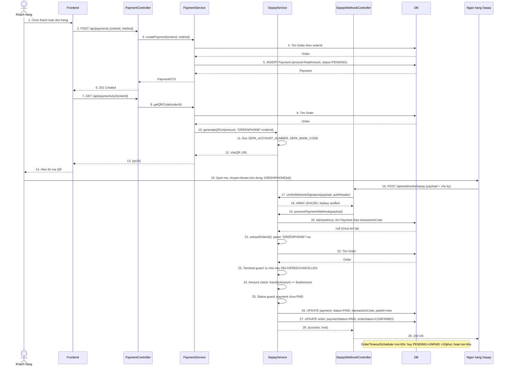
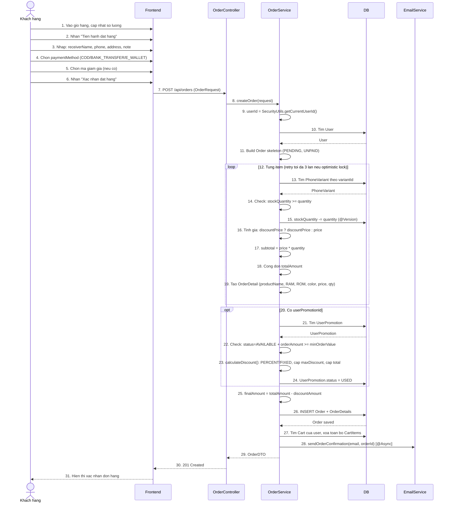
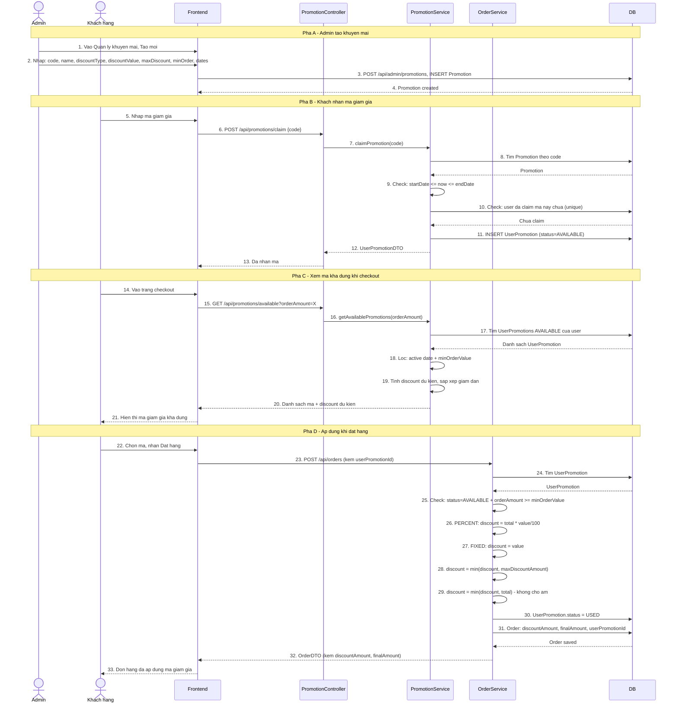
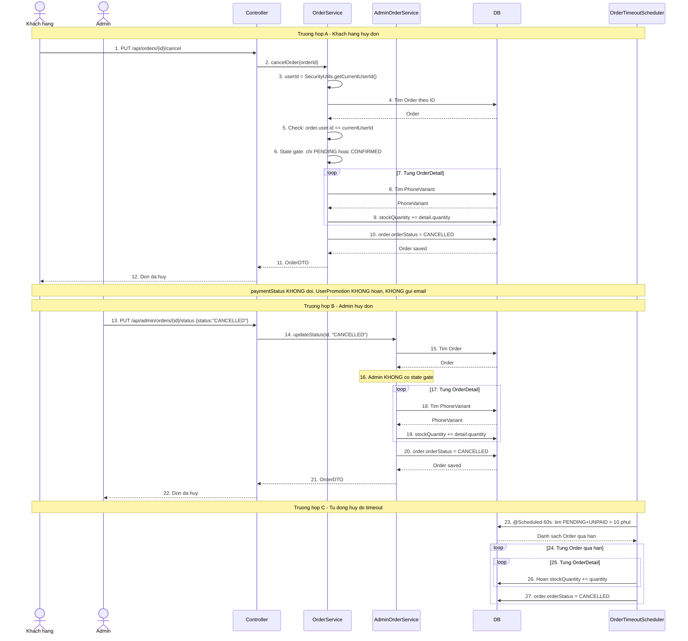

# Sơ đồ hoạt động GreenPhone (Sequence Diagram)

Dưới đây là 5 sơ đồ Mermaid dạng Sequence Diagram, được xây dựng từ source code thực tế.

---

## 1. Luồng Thanh Toán (Chuyển khoản ngân hàng)



---

## 2. Luồng Đặt Đơn



---

## 3. Luồng Áp Voucher Vào Đơn



---

## 4. Luồng Huỷ Đơn Hàng



---

## 5. Luồng Admin Thêm Điện Thoại

```mermaid
sequenceDiagram
    actor Admin
    participant FE as Frontend
    participant Ctrl as AdminPhoneController
    participant Svc as AdminPhoneService
    participant CloudSvc as CloudinaryService
    participant Cloud as Cloudinary
    participant DB

    Note over Admin,DB: Buoc 1 - Tao thong tin dien thoai

    Admin->>FE: 1. Vao Quan ly dien thoai, Them moi
    Admin->>FE: 2. Nhap: brandId, name, description
    Admin->>FE: 3. Nhap thong so: screen, os, chip, camera, battery, warranty
    Admin->>FE: 4. Nhan "Tao"

    FE->>Ctrl: 5. POST /api/admin/phones (PhoneRequest)
    Ctrl->>Svc: 6. createPhone(request)

    Svc->>DB: 7. Tim Brand theo brandId
    DB-->>Svc: Brand

    Svc->>Svc: 8. Build Phone entity (status=ACTIVE)
    Svc->>DB: 9. INSERT PHONE
    DB-->>Svc: Phone (co id)

    Svc-->>Ctrl: 10. PhoneDTO
    Ctrl-->>FE: 11. 201 Created (phoneId)
    FE-->>Admin: 12. Hien thi phoneId

    Note over Admin,DB: Buoc 2 - Them bien the (RAM/ROM/Mau/Gia/Ton)

    loop 13. Moi bien the
        Admin->>FE: 14. Nhap: ram, storage, color, price, discountPrice, stockQuantity
        Admin->>FE: 15. Nhan "Them bien the"

        FE->>Ctrl: 16. POST /api/admin/phones/{id}/variants
        Ctrl->>Svc: 17. addVariant(phoneId, request)

        Svc->>DB: 18. Tim Phone
        DB-->>Svc: Phone

        Svc->>Svc: 19. Build PhoneVariant (status=ACTIVE, @Version auto)
        Svc->>DB: 20. INSERT PHONE_VARIANT
        Note over DB: 21. UNIQUE(phoneId, ram, storage, color)

        DB-->>Svc: PhoneVariant
        Svc-->>Ctrl: 22. PhoneVariantDTO
        Ctrl-->>FE: 23. 201 Created
        FE-->>Admin: 24. Bien the da them
    end

    Note over Admin,DB: Buoc 3 - Upload anh san pham

    loop 25. Moi anh
        Admin->>FE: 26. Chon file anh tu may
        Admin->>FE: 27. Nhan "Upload"

        FE->>Ctrl: 28. POST /api/admin/phones/{id}/images (multipart)
        Ctrl->>Svc: 29. addImage(phoneId, file)

        Svc->>DB: 30. Tim Phone
        DB-->>Svc: Phone

        Svc->>CloudSvc: 31. uploadImage(file, "greenphone/phones")

        CloudSvc->>CloudSvc: 32. Validate: file, contentType=image/*, size<=10MB
        CloudSvc->>CloudSvc: 33. public_id = UUID.randomUUID()
        CloudSvc->>Cloud: 34. uploader.upload(bytes, folder="greenphone/phones")
        Cloud-->>CloudSvc: 35. secure_url

        CloudSvc-->>Svc: 36. imageUrl

        Svc->>DB: 37. Check: anh dau tien cua phone
        Svc->>Svc: 38. Anh dau: isMain=true; anh sau: false
        Svc->>DB: 39. INSERT PHONE_IMAGE (imageUrl, isMain)
        DB-->>Svc: PhoneImage

        Svc-->>Ctrl: 40. PhoneImageDTO
        Ctrl-->>FE: 41. 201 Created
        FE-->>Admin: 42. Anh da upload
    end

    Note over Admin,DB: Buoc 4 - Dat anh chinh va xem tong quan

    Admin->>FE: 43. Chon anh lam anh chinh
    FE->>Ctrl: 44. PUT /api/admin/phones/{id}/images/{imgId} {isMain:true}
    Ctrl->>Svc: 45. updateImage(phoneId, imageId, request)

    Svc->>DB: 46. Set tat ca anh khac isMain=false
    Svc->>DB: 47. Set anh duoc chon isMain=true
    DB-->>Svc: Updated

    Svc-->>Ctrl: 48. PhoneImageDTO
    Ctrl-->>FE: 49. OK
    FE-->>Admin: 50. Anh chinh da cap nhat

    Admin->>FE: 51. Xem tong quan san pham
    FE->>Ctrl: 52. GET /api/admin/phones/{id}
    Ctrl->>DB: 53. Query Phone + Variants + Images
    DB-->>Ctrl: Full detail
    Ctrl-->>FE: 54. PhoneDetailDTO
    FE-->>Admin: 55. Hien thi tong quan, SP da san sang
```

---

> **Nguon**: So do duoc xay dung tu source code thuc te:
> - `OrderService.java` — dat don, huy don
> - `PaymentService.java`, `SepayService.java`, `SepayWebhookController.java` — thanh toan
> - `PromotionService.java`, `AdminPromotionService.java` — khuyen mai
> - `AdminPhoneService.java`, `CloudinaryService.java` — admin them dien thoai
> - `greenphone.sql` — schema va rang buoc
> - `phan tich module.txt`, `api-listing.txt` — chuc nang va API
